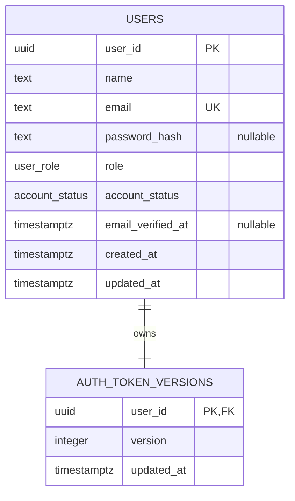

# Data model

This document describes the implemented database model. Drizzle table
definitions in `src/modules/` are the implementation source of truth; update
this document whenever entities or relationships change.

The readable [target domain ERD](erd.md) explores the broader model implied by
the functional requirements, with an [editable diagrams.net source](erd.drawio).
It is a design input, not a representation of the current database, and must be
reconciled with this document as features are implemented. Its upstream
diagrams.net file is available in
[Google Drive](https://app.diagrams.net/#G1fQqzUKwOfsyoHleLbRbM1uaNwr-d5GiQ#%7B%22pageId%22%3A%22erd-v3-3%22%7D).

## Entity relationship diagram

## Users

Owned by the `users` module and defined in
`src/modules/users/users.table.ts`.

| Column | Type | Constraints | Purpose |
| --- | --- | --- | --- |
| `user_id` | UUID | Primary key, generated | Stable user identifier |
| `name` | Text | Required, nonblank | Display name |
| `email` | Text | Required, normalized, case-insensitively unique | Normalized sign-in/contact address |
| `password_hash` | Text | Nullable | Password-derived credential; never returned by the API |
| `role` | `user_role` | Required, defaults to `candidate` | Authorization category |
| `account_status` | `account_status` | Required, defaults to `active` | Account lifecycle state |
| `email_verified_at` | Timestamp with time zone | Nullable | Email verification time |
| `created_at` | Timestamp with time zone | Required, generated | Creation time |
| `updated_at` | Timestamp with time zone | Required, generated | Last update time |

### Enumerations

- `user_role`: `candidate`, `reviewer`, `admin`
- `account_status`: `active`, `suspended`, `disabled`

## Authentication token versions

Owned by the `auth` module and defined in
`src/modules/auth/auth.table.ts`.

`auth_token_versions` stores one nonnegative version per user. Each 15-minute
access JWT includes the version that was current when it was issued. Guards
compare the JWT claim with this table on every authenticated request. Logout,
password changes, and security-sensitive account actions increment the stored
version, invalidating every previously issued JWT. The row cascades on user
deletion.

| Column | Type | Constraints | Purpose |
| --- | --- | --- | --- |
| `user_id` | UUID | Primary key, user FK, cascade delete | Token owner |
| `version` | Integer | Required, nonnegative, defaults to `0` | Current valid JWT version |
| `updated_at` | Timestamp with time zone | Required, generated | Last invalidation time |

## Maintenance rules

- Keep physical column details aligned with the owning Drizzle table.
- Show foreign-key cardinality in the ER diagram when relationships are added.
- Record the business meaning of relationships and important constraints here.
- Update the target domain ERD when requirements change its entities or
  relationships; update this document only when the implemented schema changes.
- Use migrations for database evolution; do not treat this document as an
  executable schema.
