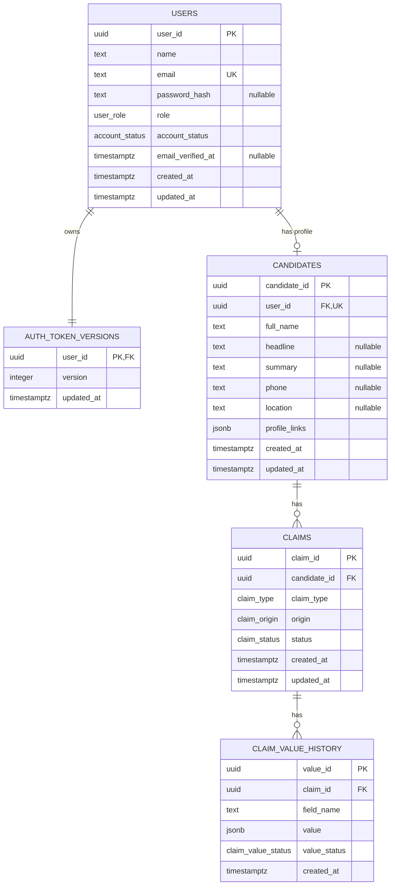

# Data model

This document describes the implemented database model. Drizzle table
definitions in `src/modules/` are the implementation source of truth; update
this document whenever entities or relationships change.

The readable [target domain ERD](erd.md) explores the broader model implied by
the functional requirements, with an [editable diagrams.net source](erd.drawio).
It is a design input, not a representation of the current database, and must be
reconciled with this document as features are implemented. Its upstream
diagrams.net file is available in
[Google Drive](https://app.diagrams.net/#G1fQqzUKwOfsyoHleLbRbM1uaNwr-d5GiQ#%7B%22pageId%22%3A%22erd-v3-3%22%7D).

## Entity relationship diagram

## Users

Owned by the `users` module and defined in
`src/modules/users/users.table.ts`.

| Column | Type | Constraints | Purpose |
| --- | --- | --- | --- |
| `user_id` | UUID | Primary key, generated | Stable user identifier |
| `name` | Text | Required, nonblank | Display name |
| `email` | Text | Required, normalized, case-insensitively unique | Normalized sign-in/contact address |
| `password_hash` | Text | Nullable | Password-derived credential; never returned by the API |
| `role` | `user_role` | Required, defaults to `candidate` | Authorization category |
| `account_status` | `account_status` | Required, defaults to `active` | Account lifecycle state |
| `email_verified_at` | Timestamp with time zone | Nullable | Email verification time |
| `created_at` | Timestamp with time zone | Required, generated | Creation time |
| `updated_at` | Timestamp with time zone | Required, generated | Last update time |

### Enumerations

- `user_role`: `candidate`, `reviewer`, `admin`
- `account_status`: `active`, `suspended`, `disabled`

## Authentication token versions

Owned by the `auth` module and defined in
`src/modules/auth/auth.table.ts`.

`auth_token_versions` stores one nonnegative version per user. Each 15-minute
access JWT includes the version that was current when it was issued. Guards
compare the JWT claim with this table on every authenticated request. Logout,
password changes, and security-sensitive account actions increment the stored
version, invalidating every previously issued JWT. The row cascades on user
deletion.

| Column | Type | Constraints | Purpose |
| --- | --- | --- | --- |
| `user_id` | UUID | Primary key, user FK, cascade delete | Token owner |
| `version` | Integer | Required, nonnegative, defaults to `0` | Current valid JWT version |
| `updated_at` | Timestamp with time zone | Required, generated | Last invalidation time |

## Candidates

Owned by the `candidates` module and defined in
`src/modules/candidates/candidates.table.ts`.

`candidates` stores one profile per user with the candidate's personal
information. The email address is not duplicated; it is read from the user
through the users service. The row cascades on user deletion.

| Column | Type | Constraints | Purpose |
| --- | --- | --- | --- |
| `candidate_id` | UUID | Primary key, generated | Stable profile identifier |
| `user_id` | UUID | Required, unique, user FK, cascade delete | Profile owner |
| `full_name` | Text | Required, nonblank | Name shown on the profile |
| `headline` | Text | Nullable | Professional title, such as "Backend Developer" |
| `summary` | Text | Nullable | Professional summary |
| `phone` | Text | Nullable | Contact phone number |
| `location` | Text | Nullable | Candidate location |
| `profile_links` | JSONB | Required, defaults to `[]` | `{ label, url }` links such as LinkedIn or GitHub |
| `created_at` | Timestamp with time zone | Required, generated | Creation time |
| `updated_at` | Timestamp with time zone | Required, generated | Last update time |

## Claims

Owned by the `candidates` module.

A claim is one piece of profile information: a skill, an employment record,
an education record, or a certification. Claims entered by the candidate are
stored as `manual` and `accepted`. Only accepted claims appear in the exported
profile; pending and rejected claims are excluded. Claims cascade on profile
deletion.

| Column | Type | Constraints | Purpose |
| --- | --- | --- | --- |
| `claim_id` | UUID | Primary key, generated | Stable claim identifier |
| `candidate_id` | UUID | Required, candidate FK, cascade delete, indexed | Claim owner |
| `claim_type` | `claim_type` | Required | Kind of profile information |
| `origin` | `claim_origin` | Required | Whether the candidate entered or extraction produced the claim |
| `status` | `claim_status` | Required, defaults to `pending` | Review state; only `accepted` is exported |
| `created_at` | Timestamp with time zone | Required, generated | Creation time |
| `updated_at` | Timestamp with time zone | Required, generated | Last value change |

## Claim value history

Owned by the `candidates` module.

`claim_value_history` stores claim values with one row per field. Editing a
claim marks the field's current row as `superseded` and inserts a new
`current` row, preserving original values. A partial unique index allows only
one `current` row per claim field. Rows cascade on claim deletion.

| Column | Type | Constraints | Purpose |
| --- | --- | --- | --- |
| `value_id` | UUID | Primary key, generated | Stable value identifier |
| `claim_id` | UUID | Required, claim FK, cascade delete, indexed | Owning claim |
| `field_name` | Text | Required, nonblank | Claim field, such as `jobTitle` |
| `value` | JSONB | Required | Field value: a string, or a string array for employment skills |
| `value_status` | `claim_value_status` | Required, defaults to `current` | Whether the value is current or superseded |
| `created_at` | Timestamp with time zone | Required, generated | Time the value was recorded |

Claim fields by type, with dates stored as `YYYY-MM`:

| Claim type | Required fields | Optional fields |
| --- | --- | --- |
| `skill` | `name` | — |
| `employment` | `employer`, `jobTitle`, `startDate` | `endDate`, `description`, `location`, `skills` |
| `education` | `institution`, `degree`, `startDate` | `fieldOfStudy`, `endDate` |
| `certification` | `title`, `issuer`, `issueDate` | `expiryDate`, `credentialId` |

### Enumerations

- `claim_type`: `skill`, `employment`, `education`, `certification`
- `claim_origin`: `manual`, `extracted`
- `claim_status`: `pending`, `accepted`, `rejected`
- `claim_value_status`: `current`, `superseded`

### Not yet implemented

The [target domain ERD](erd.md) includes claim details that belong to later
features and are intentionally not part of the current schema:

- `claims.confidence_score`, `claims.matched_claim_id`, and
  `claims.match_status` arrive with extraction and duplicate matching.
- `claim_value_history.validation_status` arrives with extraction review.
- `source_occurrences`, which links extracted claims to their source document
  and location, arrives with document upload and parsing. Exported claims
  already include an empty `sources` array for these references.

## Maintenance rules

- Keep physical column details aligned with the owning Drizzle table.
- Show foreign-key cardinality in the ER diagram when relationships are added.
- Record the business meaning of relationships and important constraints here.
- Update the target domain ERD when requirements change its entities or
  relationships; update this document only when the implemented schema changes.
- Use migrations for database evolution; do not treat this document as an
  executable schema.
