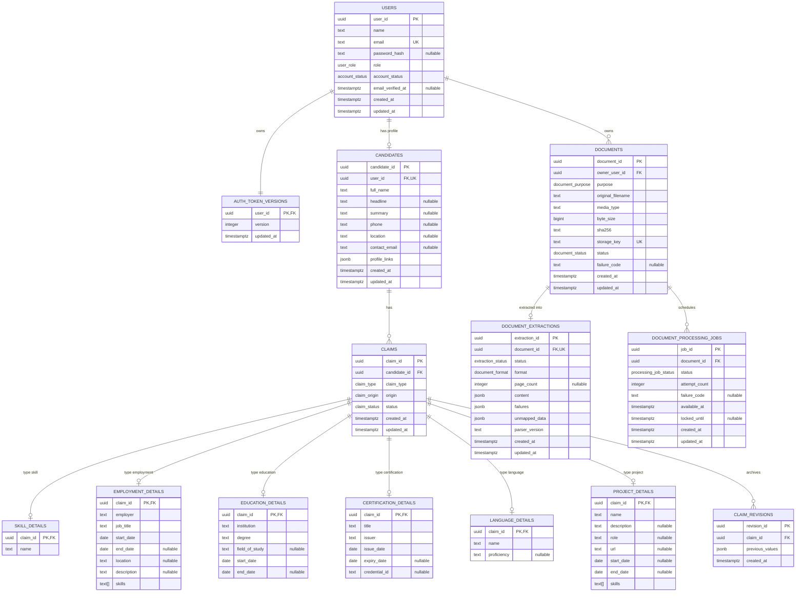
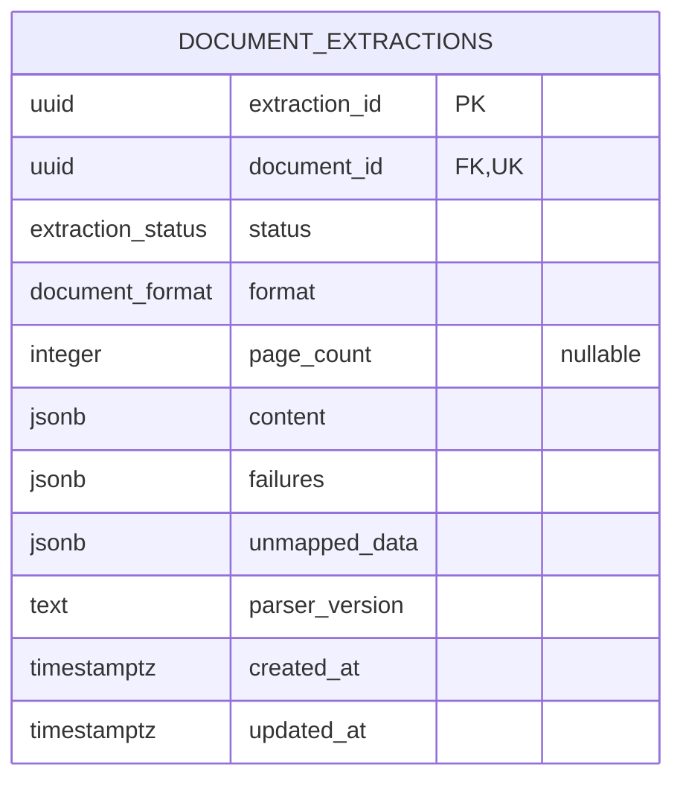

# Data model

This document describes the implemented database model. Drizzle table
definitions in `src/modules/` are the implementation source of truth; update
this document whenever entities or relationships change.

The readable [target domain ERD](erd.md) explores the broader model implied by
the functional requirements, with an [editable diagrams.net source](erd.drawio).
It is a design input, not a representation of the current database, and must be
reconciled with this document as features are implemented. Its upstream
diagrams.net file is available in
[Google Drive](https://app.diagrams.net/#G1fQqzUKwOfsyoHleLbRbM1uaNwr-d5GiQ#%7B%22pageId%22%3A%22erd-v3-3%22%7D).

## Entity relationship diagram

## Users

Owned by the `users` module and defined in
`src/modules/users/users.table.ts`.

| Column | Type | Constraints | Purpose |
| --- | --- | --- | --- |
| `user_id` | UUID | Primary key, generated | Stable user identifier |
| `name` | Text | Required, nonblank | Display name |
| `email` | Text | Required, normalized, case-insensitively unique | Normalized sign-in/contact address |
| `password_hash` | Text | Nullable | Password-derived credential; never returned by the API |
| `role` | `user_role` | Required, defaults to `candidate` | Authorization category |
| `account_status` | `account_status` | Required, defaults to `active` | Account lifecycle state |
| `email_verified_at` | Timestamp with time zone | Nullable | Email verification time |
| `created_at` | Timestamp with time zone | Required, generated | Creation time |
| `updated_at` | Timestamp with time zone | Required, generated | Last update time |

### Enumerations

- `user_role`: `candidate`, `reviewer`, `admin`
- `account_status`: `active`, `suspended`, `disabled`

## Authentication token versions

Owned by the `auth` module and defined in
`src/modules/auth/auth.table.ts`.

`auth_token_versions` stores one nonnegative version per user. Each 15-minute
access JWT includes the version that was current when it was issued. Guards
compare the JWT claim with this table on every authenticated request. Logout,
password changes, and security-sensitive account actions increment the stored
version, invalidating every previously issued JWT. The row cascades on user
deletion.

| Column | Type | Constraints | Purpose |
| --- | --- | --- | --- |
| `user_id` | UUID | Primary key, user FK, cascade delete | Token owner |
| `version` | Integer | Required, nonnegative, defaults to `0` | Current valid JWT version |
| `updated_at` | Timestamp with time zone | Required, generated | Last invalidation time |

## Candidates

Owned by the `candidates` module and defined in
`src/modules/candidates/candidates.table.ts`.

`candidates` stores one profile per user with the candidate's personal
information. The email address is not duplicated; it is read from the user
through the users service. The row cascades on user deletion.

| Column | Type | Constraints | Purpose |
| --- | --- | --- | --- |
| `candidate_id` | UUID | Primary key, generated | Stable profile identifier |
| `user_id` | UUID | Required, unique, user FK, cascade delete | Profile owner |
| `full_name` | Text | Required, nonblank | Name shown on the profile |
| `headline` | Text | Nullable | Professional title, such as "Backend Developer" |
| `summary` | Text | Nullable | Professional summary |
| `phone` | Text | Nullable | Contact phone number |
| `location` | Text | Nullable | Candidate location |
| `contact_email` | Text | Nullable, valid email | Email shown on the CV and profile; can differ from the account email |
| `profile_links` | JSONB | Required, defaults to `[]` | `{ label, url }` links such as LinkedIn or GitHub |
| `created_at` | Timestamp with time zone | Required, generated | Creation time |
| `updated_at` | Timestamp with time zone | Required, generated | Last update time |

## Claims

Owned by the `candidates` module.

A claim is one piece of profile information: a skill, an employment record,
an education record, a certification, a language, or a project. Claims entered
by the candidate are stored as `manual` and `accepted`. Only accepted claims
appear in the exported profile; pending and rejected claims are excluded.
Claims cascade on profile deletion.

| Column | Type | Constraints | Purpose |
| --- | --- | --- | --- |
| `claim_id` | UUID | Primary key, generated | Stable claim identifier |
| `candidate_id` | UUID | Required, candidate FK, cascade delete, indexed | Claim owner |
| `claim_type` | `claim_type` | Required | Kind of profile information |
| `origin` | `claim_origin` | Required | Whether the candidate entered or extraction produced the claim |
| `status` | `claim_status` | Required, defaults to `pending` | Review state; only `accepted` is exported |
| `created_at` | Timestamp with time zone | Required, generated | Creation time |
| `updated_at` | Timestamp with time zone | Required, generated | Last value change |

## Claim details

Owned by the `candidates` module.

Each claim has exactly one details row, stored in the table that matches its
`claim_type`. The details table uses `claim_id` as both its primary key and its
claim foreign key, and rows cascade on claim deletion. Real columns, rather
than generic JSON values, let profile search query and index claim data
directly, such as finding candidates with a given skill.

The API exchanges dates as `YYYY-MM`. The database stores them as `date` values
on the first day of the month, so durations can be calculated and records can
be sorted by date. Optional fields are omitted from API values when empty.

### `skill_details`

| Column | Type | Constraints | Purpose |
| --- | --- | --- | --- |
| `claim_id` | UUID | Primary key, claim FK, cascade delete | Owning claim |
| `name` | Text | Required, indexed case-insensitively | Skill name |

### `employment_details`

| Column | Type | Constraints | Purpose |
| --- | --- | --- | --- |
| `claim_id` | UUID | Primary key, claim FK, cascade delete | Owning claim |
| `employer` | Text | Required | Employer name |
| `job_title` | Text | Required | Job title |
| `start_date` | Date | Required | First month of employment |
| `end_date` | Date | Nullable, not before `start_date` | Last month; null for a current role |
| `location` | Text | Nullable | Work location, such as "Remote" |
| `description` | Text | Nullable | Role description |
| `skills` | Text array | Required, defaults to empty, GIN indexed | Skills used in the role |

### `education_details`

| Column | Type | Constraints | Purpose |
| --- | --- | --- | --- |
| `claim_id` | UUID | Primary key, claim FK, cascade delete | Owning claim |
| `institution` | Text | Required | Educational institution |
| `degree` | Text | Required | Degree, such as "BSc" |
| `field_of_study` | Text | Nullable | Field of study |
| `start_date` | Date | Required | First month of study |
| `end_date` | Date | Nullable, not before `start_date` | Last month; null while studying |

### `certification_details`

| Column | Type | Constraints | Purpose |
| --- | --- | --- | --- |
| `claim_id` | UUID | Primary key, claim FK, cascade delete | Owning claim |
| `title` | Text | Required | Certificate title |
| `issuer` | Text | Required | Issuing organization |
| `issue_date` | Date | Required | Issue month |
| `expiry_date` | Date | Nullable, not before `issue_date` | Expiry month |
| `credential_id` | Text | Nullable | Issuer credential identifier |

### `language_details`

| Column | Type | Constraints | Purpose |
| --- | --- | --- | --- |
| `claim_id` | UUID | Primary key, claim FK, cascade delete | Owning claim |
| `name` | Text | Required | Language, such as "English" |
| `proficiency` | Text | Nullable | Level as written, such as "Native" or "C1"; one scale is left to normalization |

### `project_details`

Many CVs list projects without dates, so both dates are optional.

| Column | Type | Constraints | Purpose |
| --- | --- | --- | --- |
| `claim_id` | UUID | Primary key, claim FK, cascade delete | Owning claim |
| `name` | Text | Required | Project name |
| `description` | Text | Nullable | What the project does |
| `role` | Text | Nullable | The candidate's role, such as "Backend developer" |
| `url` | Text | Nullable, valid URL | Project or repository link |
| `start_date` | Date | Nullable | First month of the project |
| `end_date` | Date | Nullable, not before `start_date` when both are set | Last month |
| `skills` | Text array | Required, defaults to empty, GIN indexed | Skills used in the project |

## Claim revisions

Owned by the `candidates` module.

Before a claim's details are edited, its previous values are archived in
`claim_revisions` in the API shape (camelCase fields, `YYYY-MM` dates). The
details tables therefore always hold current values, and the oldest revision of
an edited claim holds its original values. Unchanged edits create no revision.
Revisions are not searched and cascade on claim deletion.

| Column | Type | Constraints | Purpose |
| --- | --- | --- | --- |
| `revision_id` | UUID | Primary key, generated | Stable revision identifier |
| `claim_id` | UUID | Required, claim FK, cascade delete, indexed | Edited claim |
| `previous_values` | JSONB | Required | Complete claim values before the edit |
| `created_at` | Timestamp with time zone | Required, generated | Edit time |

### Enumerations

- `claim_type`: `skill`, `employment`, `education`, `certification`,
  `language`, `project`
- `claim_origin`: `manual`, `extracted`
- `claim_status`: `pending`, `accepted`, `rejected`

## Documents

Owned by the `documents` module and defined in
`src/modules/documents/documents.table.ts`.

Documents store metadata for candidate-owned source and evidence files. The
file bytes remain in private storage and are addressed by an opaque, unique
storage key. Document rows cascade when their owning user is deleted.

| Column | Type | Constraints | Purpose |
| --- | --- | --- | --- |
| `document_id` | UUID | Primary key, generated | Stable document identifier |
| `owner_user_id` | UUID | Required, user FK, cascade delete, indexed | Document owner |
| `purpose` | `document_purpose` | Required | Source or evidence classification |
| `original_filename` | Text | Required, nonblank | Client-visible original filename |
| `media_type` | Text | Required | Server-verified content type |
| `byte_size` | Bigint | Required, positive | Size of the original file in bytes |
| `sha256` | Text | Required, indexed with owner | SHA-256 checksum of the original bytes |
| `storage_key` | Text | Required, unique | Opaque storage identifier |
| `status` | `document_status` | Required, defaults to `stored` | Document lifecycle state |
| `failure_code` | Text | Nullable | Machine-readable processing failure |
| `created_at` | Timestamp with time zone | Required, generated, indexed with owner | Creation time |
| `updated_at` | Timestamp with time zone | Required, generated | Last lifecycle update |

### Document enumerations

- `document_purpose`: `source`, `evidence`
- `document_status`: `stored`, `processing`, `ready`, `failed`, `deleting`

## Document processing jobs

Owned by the `document-processing` module and defined in
`src/modules/document-processing/document-processing.table.ts`. See
[Asynchronous document processing](../modules/document-processing.md) for the
workflow design.

`document_processing_jobs` stores durable scheduling, retry, and lease state
for asynchronous parsing. A document may have multiple jobs over its lifetime;
the job ID is the idempotency key carried by queue messages. Deleting a
document deletes its processing history.

| Column | Type | Constraints | Purpose |
| --- | --- | --- | --- |
| `job_id` | UUID | Primary key, generated | Stable job and message idempotency identifier |
| `document_id` | UUID | Required, document FK, cascade delete, indexed | Document to process |
| `status` | `processing_job_status` | Required, defaults to `queued`, indexed | Processing lifecycle state |
| `attempt_count` | Integer | Required, nonnegative, defaults to `0` | Number of processing attempts |
| `failure_code` | Text | Nullable | Machine-readable reason for a retry or terminal failure |
| `available_at` | Timestamp with time zone | Required, generated, indexed with status | Earliest time the job may run |
| `locked_until` | Timestamp with time zone | Nullable, indexed with status | Processing lease expiration |
| `created_at` | Timestamp with time zone | Required, generated | Creation time |
| `updated_at` | Timestamp with time zone | Required, generated | Last lifecycle update |

### Processing job enumeration

- `processing_job_status`: `queued`, `processing`, `retrying`, `completed`,
  `failed`

### Not yet implemented

The [target domain ERD](erd.md) includes claim details that belong to later
features and are intentionally not part of the current schema:

- `claims.confidence_score`, `claims.matched_claim_id`, and
  `claims.match_status` arrive with extraction and duplicate matching.
- Field-level validation flags for low-confidence extracted values, previously
  modeled as `ClaimValueHistory.validation_status`, are left to the extraction
  review feature to place.
- `source_occurrences`, which links extracted claims to their source document
  and location, arrives with document upload and parsing. Exported claims
  already include an empty `sources` array for these references.

## Document extractions

Owned by the `parsing` module and defined in
`src/modules/parsing/parsing.table.ts`. See
[Document parsing](../modules/parsing.md) for the design.

`document_extractions` stores the text extracted from one source document.
PDF results keep pages, layout regions, lines, and on-page coordinates; DOCX
results keep ordered paragraph and table blocks. Parsing a document again
replaces its row. Deleting a document deletes its extraction.

| Column | Type | Constraints | Purpose |
| --- | --- | --- | --- |
| `extraction_id` | UUID | Primary key, generated | Stable extraction identifier |
| `document_id` | UUID | Required, unique, document FK, cascade delete | Parsed document |
| `status` | `extraction_status` | Required | Whether every page, some pages, or nothing was extracted |
| `format` | `document_format` | Required | Parsed file format |
| `page_count` | Integer | Nullable, positive | PDF page count; null for DOCX or unopened files |
| `content` | JSONB | Required | `{ version, pages, blocks }`, described below |
| `failures` | JSONB | Required, defaults to `[]` | Failed pages or file with an error code, such as `NO_TEXT_LAYER` or `UNSUPPORTED_LANGUAGE` |
| `unmapped_data` | JSONB | Required, defaults to `[]` | Information outside the profile schema, such as courses or awards, or items that could not become claims; filled by the AI-output mapping |
| `parser_version` | Text | Required | Library and version that produced the result |
| `created_at` | Timestamp with time zone | Required, generated | First extraction time |
| `updated_at` | Timestamp with time zone | Required, generated | Latest extraction time |

### Enumerations

- `extraction_status`: `succeeded`, `partial`, `failed`
- `document_format`: `pdf`, `docx`

### Content shape

`content.version` is `3`. Code that reads `content` checks the version, so
results saved in an older shape can be told apart.

- `pages` (PDF; empty for DOCX): each page has `pageNumber`, `width`,
  `height`, and ordered `regions`.
  - A region has `index` (from 0), `box`, `confidence` (the score of the split
    that created it, or `null` when not split), and ordered `lines`.
  - A line has `order` (reading order across the whole document, unique, from
    1), `text`, `box`, `heading`, `bold`, `italic`, `bullet`, and `links`.
  - A `box` is `{ x, y, width, height }` in PDF points from the page's
    top-left corner.
- `blocks` (DOCX; empty for PDF): ordered blocks with an `index`.
  - A paragraph has `text`, `heading`, `bold`, `italic`, and `links`.
  - A table has `columns` (the header row when Word marks one, else `null`)
    and `rows`, each a list of cell texts.

### Unmapped data shape

Each item in `unmapped_data` has a `label` (the CV section or field, such as
"Courses & Certifications"), the `text`, its `sources` as AI-input line
references (such as `L12` or `B3`), and a `reason`, such as
`unsupported_section` or `missing_start_date`. The parser does not fill it, and
parsing a document again does not clear it yet; that is decided with the
AI-output mapping.

## Maintenance rules

- Keep physical column details aligned with the owning Drizzle table.
- Show foreign-key cardinality in the ER diagram when relationships are added.
- Record the business meaning of relationships and important constraints here.
- Update the target domain ERD when requirements change its entities or
  relationships; update this document only when the implemented schema changes.
- Use migrations for database evolution; do not treat this document as an
  executable schema.
