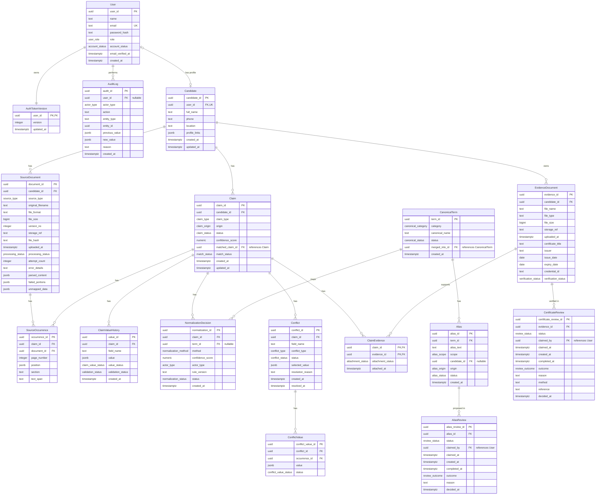

# Proposed domain ERD

based on the functional requirements and does not represent the currently implemented database.

Attribute types are proposed PostgreSQL-oriented domain types. They become
authoritative only when implemented in the owning module's Drizzle tables.

See [Data model](data-model.md) for the implemented schema.

