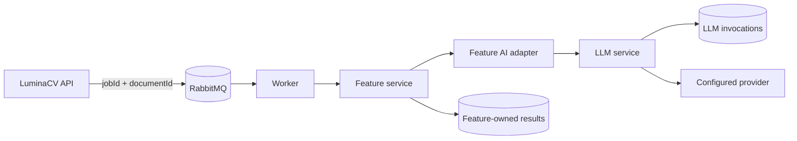
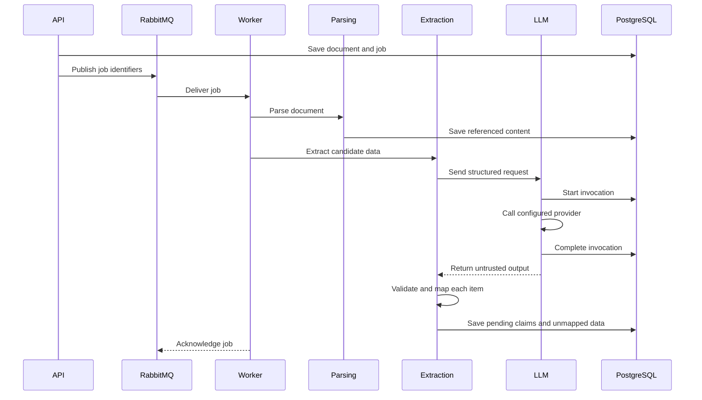
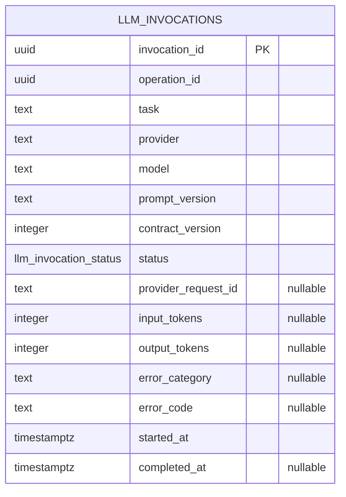

# LLM integration design

## Goal

Add LLM-backed features without coupling LuminaCV to one provider or moving
feature rules into a shared AI module.

The first use case is extracting structured candidate information from parsed
CV text (`FR-DE-01` through `FR-DE-08`). The same integration can later support
reading order, contextual normalization, conflict comparison, and evidence
extraction.

Gemini is the development provider for now, with the model configured as
`gemini-3.5-flash-lite`. Provider and model names stay in configuration so they
can change without affecting feature code.

## Main decisions

1. The provider client belongs in `infrastructure/llm`.
2. Each feature owns its prompts, schemas, validation, and decision rules.
3. Model output is `unknown` until the owning feature validates it.
4. RabbitMQ delivers durable workflows, not individual LLM calls.
5. Queue messages contain identifiers only, never CV text or model output.
6. LLM invocation data is separate from processing jobs and feature results.
7. One invocation row represents one actual provider request.
8. Deterministic matching runs before contextual LLM matching.
9. AI suggestions never bypass candidate or reviewer approval.

## Architecture



The responsibilities stay deliberately small:

| Component | Responsibility |
| --- | --- |
| Feature service | Business workflow, validation, persistence, and review rules |
| Feature AI adapter | Prompt, output schema, task version, and model policy |
| LLM service | Invocation tracking, provider call, timeout, and safe error mapping |
| Provider adapter | Provider-specific authentication and request/response mapping |
| Worker | Durable processing, retries, and acknowledgement |
| RabbitMQ | Identifier-only job delivery and dead-lettering |

Suggested structure:

```text
src/
├── infrastructure/
│   └── llm/
│       ├── llm-client.ts
│       ├── llm.service.ts
│       ├── llm.repository.ts
│       ├── llm.table.ts
│       ├── llm.errors.ts
│       ├── gemini-llm-client.ts
│       └── index.ts
├── modules/
│   ├── extraction/
│   │   ├── extraction.ai.ts
│   │   ├── extraction.prompt.ts
│   │   └── extraction.service.ts
│   ├── parsing/
│   │   └── reading-order.ai.ts          # later
│   └── normalization/
│       └── normalization.ai-matcher.ts  # later
└── workers/
    └── document-processing...
```

## Document extraction flow

The existing document-processing job remains the initial unit of work. There
is no separate queue for every internal stage.



The model cannot write claims directly. The extraction module uses its existing
versioned schema, validator, and partial mapper. Valid items are kept even when
another item is invalid.

Queue messages continue to contain only:

```ts
interface ParseDocumentJob {
  version: 1;
  jobId: string;
  documentId: string;
}
```

Split parsing, extraction, or normalization into separate queues only when
they need different concurrency, retry, resource, or scaling policies.

## Invocation data

The LLM service owns one small table. It is independent from document jobs so
parsing, extraction, normalization, conflict, and evidence modules can all use
it.



`operation_id` is created by the calling feature and groups retries for one
logical action:

```text
candidate extraction operation
├── invocation 1: timeout
└── invocation 2: succeeded
```

It is intentionally not a foreign key to a job or one feature table. A feature
may store `invocation_id` with its validated result when it needs a direct
audit link.

Statuses are `started`, `succeeded`, and `failed`. Recommended indexes and
constraints are:

- index `operation_id`;
- index `(task, started_at)`;
- unique `(provider, provider_request_id)` when the request ID is present;
- positive contract versions and non-negative token counts;
- completion time cannot be earlier than start time.

Do not store prompts, CV text, raw responses, credentials, or feature results
in this table.

## Reliability and errors

RabbitMQ uses at-least-once delivery, so feature writes must be idempotent.
A repeated job must not create duplicate claims or decisions.

- The job owns durable retries, leases, and dead-lettering.
- Each real provider request gets its own invocation row.
- Provider SDK retries must not happen invisibly.
- A retry should reuse an already successful parse.
- Timeouts and total calls per job must be bounded.
- Item-level validation failures keep partial extraction results.
- An unusable envelope may retry according to the feature policy.

Error categories are:

| Category | Handling |
| --- | --- |
| `configuration` or `authentication` | Do not retry until configuration changes |
| `invalid_request` | Do not retry the same input unchanged |
| `rate_limited` | Retry with a bounded delay |
| `timeout` or `provider_unavailable` | Retry within the job attempt limit |
| `invalid_output` | Retry only when the feature policy allows it |

## Privacy and logging

CV content is personal data.

- Send only the content required for the task.
- Never send storage paths, credentials, or unrelated profile data.
- Treat document text as untrusted data, not instructions.
- Bound input length and output sizes.
- Keep provider credentials in environment-backed configuration.
- Do not log prompts, CV text, contact details, or raw responses.
- Log safe metadata such as task, provider, model, duration, token counts,
  status, and correlation IDs.
- Review provider retention and data-use terms before production.

The correlation IDs have different purposes:

| ID | Meaning |
| --- | --- |
| `jobId` | Durable workflow attempt and delivery |
| `operationId` | One logical feature action |
| `invocationId` | One provider call |
| `providerRequestId` | Provider-side request |

## Current and next steps

Already implemented:

- RabbitMQ document jobs, retries, leases, and dead-lettering;
- deterministic PDF/DOCX parsing and referenced AI input;
- the provider-neutral LLM client, Gemini adapter, configuration, invocation
  ledger, and fake-client coverage;
- extraction schema, item-level validation, partial mapping, and worker
  integration;
- idempotent persistence of extracted claims, unmapped data, and physical
  PDF/DOCX source occurrences;
- bounded extraction retries, permanent provenance-failure handling, and
  duplicate-delivery coverage;
- exact canonical and approved-alias normalization for claims created through
  the candidate service.

Next steps:

1. Normalize newly persisted extracted claims through the existing
   [normalization boundary](modules/normalization.md).
2. Conservatively consolidate duplicates only when exact canonical or approved
   alias decisions establish equivalence and all other significant values
   match, retaining every physical source occurrence.
3. Add broader conflict handling separately; do not treat parser-inferred
   headings as evidence or use them for semantic matching.
4. Defer fuzzy and AI-assisted matching until candidate and reviewer decisions
   are implemented.
5. Add other AI tasks only when their owning feature is implemented.

Normal tests use a fake client. Live Gemini tests are optional, manually
enabled, use synthetic content, and have strict request limits.

## Decisions

| ID | Decision |
| --- | --- |
| `LLM-DEC-001` | Provider communication belongs to infrastructure. |
| `LLM-DEC-002` | Feature modules own prompts, schemas, validation, and AI policy. |
| `LLM-DEC-003` | RabbitMQ delivers workflows, not provider calls. |
| `LLM-DEC-004` | Queue messages contain identifiers only. |
| `LLM-DEC-005` | Invocation data stays separate from processing jobs. |
| `LLM-DEC-006` | The initial ledger is one table with an opaque `operation_id`. |
| `LLM-DEC-007` | One invocation row represents one provider request. |
| `LLM-DEC-008` | Raw prompts and responses are not stored in the shared ledger. |
| `LLM-DEC-009` | Provider output remains untrusted until feature validation. |
| `LLM-DEC-010` | Deterministic normalization runs before contextual LLM matching. |
| `LLM-DEC-011` | Gemini is the initial development provider and is configuration-driven. |

## Open questions

| ID | Question | Needed by |
| --- | --- | --- |
| `LLM-OQ-001` | How should stale `started` invocations be reconciled after a worker crash? | Production |
| `LLM-OQ-002` | How long should invocation metadata be retained, and how does account deletion affect it? | Account deletion |
| `LLM-OQ-003` | Is an `llm_operations` parent table needed after more modules adopt the service? | Multi-module rollout |
| `LLM-OQ-004` | What are the maximum calls, tokens, and cost per task? | Production |
| `LLM-OQ-005` | Which provider and models are approved for production? | Production |
| `LLM-OQ-006` | How should per-stage document progress be stored so retries can reuse parsing? | Extraction persistence |
| `LLM-OQ-007` | When do stages need separate queues or concurrency limits? | Scaling |
| `LLM-OQ-008` | Are embeddings needed for contextual matching, and where should vectors live? | Normalization AI design |
