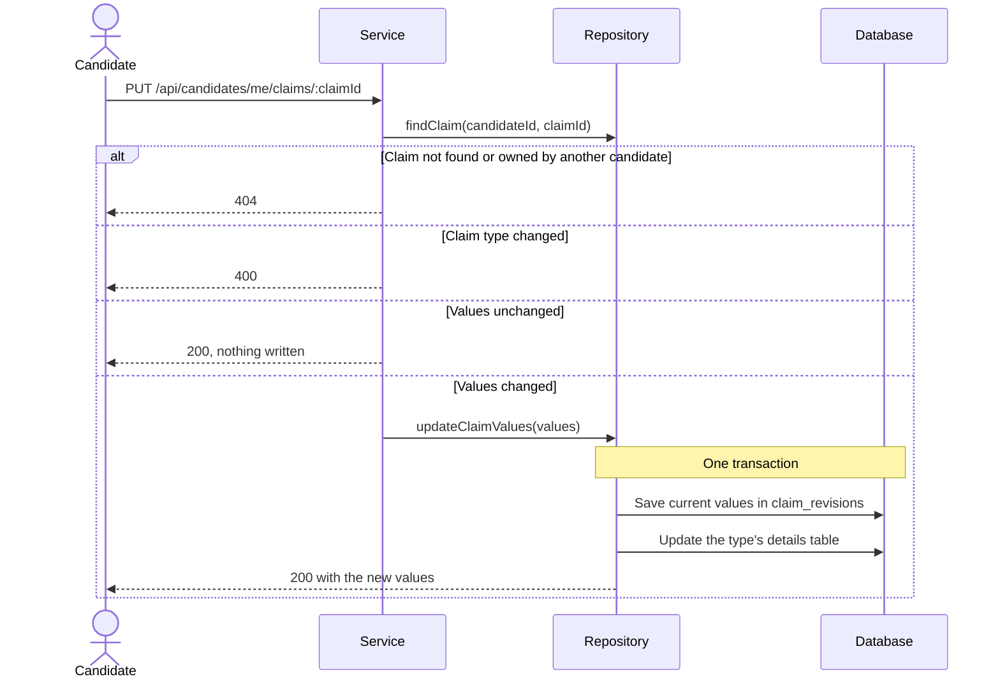
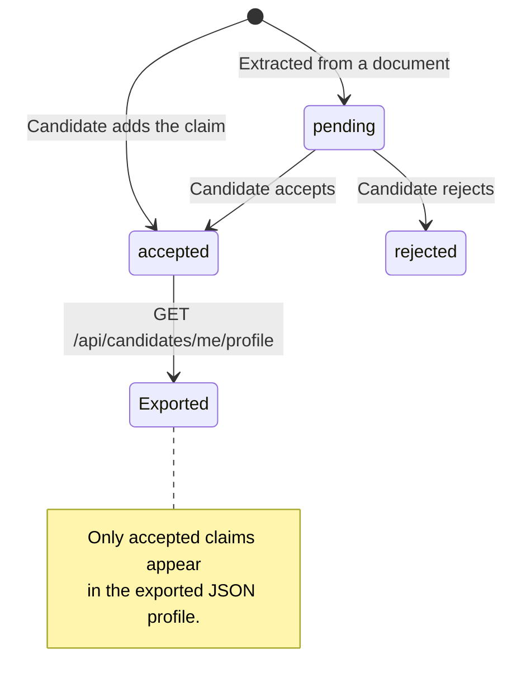

# Candidates module

The `candidates` module lets a candidate manage their profile and claims, and
exports a structured JSON profile. See the [README](../../README.md) for the
endpoints and the [Data model](../database/data-model.md) for the tables.

## Key decisions

1. **One profile per user, always `/me`.** The user comes from the access
   token, never from the URL. Another candidate's claims return 404.
2. **Every piece of profile information is a claim** with a type, an origin
   (`manual` or `extracted`), and a status (`pending`, `accepted`, or
   `rejected`). Manual claims are accepted immediately.
3. **The export contains accepted claims only.**
4. **One details table per claim type.** Real columns let profile search query
   claims directly, such as finding candidates with a given skill.
5. **Edits archive the previous values** in `claim_revisions`, so the original
   values are never lost.
6. **Ready for document parsing.** The `extracted` origin exists, and exported
   claims include an empty `sources` list for document references.

## Editing a claim

## Claim status and export

Extraction and review belong to the document parsing feature; this module
already stores and filters their statuses.
