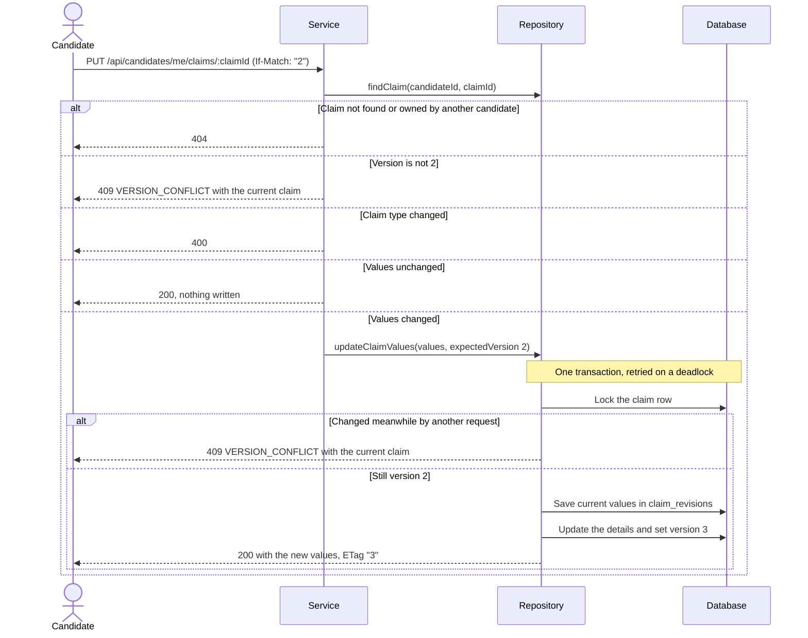
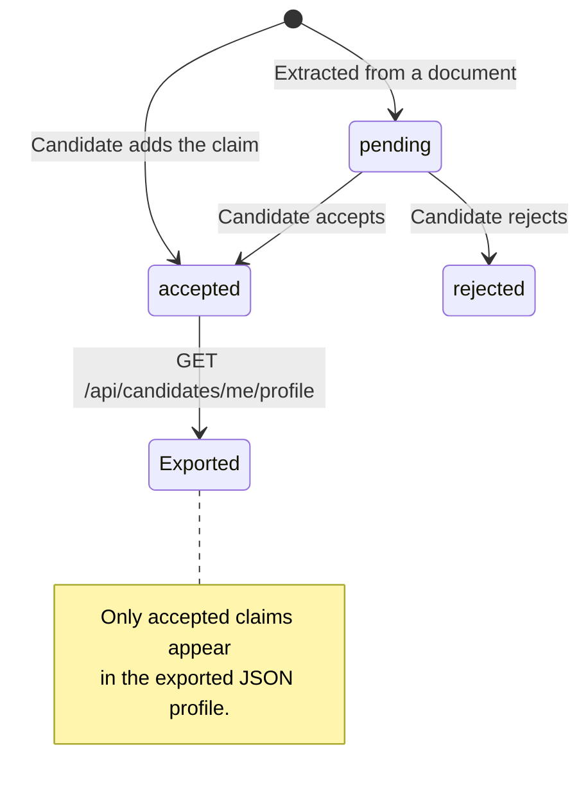

# Candidates module

The `candidates` module lets a candidate manage their profile and claims, and
exports a structured JSON profile. See the [README](../../README.md) for the
endpoints and the [Data model](../database/data-model.md) for the tables.

## Key decisions

1. **One profile per user, always `/me`.** The user comes from the access
   token, never from the URL. Another candidate's claims return 404.
2. **Every piece of profile information is a claim** with a type, an origin
   (`manual` or `extracted`), and a status (`pending`, `accepted`, or
   `rejected`). Manual claims are accepted immediately.
3. **The export contains accepted claims only.**
4. **One details table per claim type.** Real columns let profile search query
   claims directly, such as finding candidates with a given skill.
5. **Edits archive the previous values** in `claim_revisions`, so the original
   values are never lost.
6. **Extracted evidence is physical.** New extracted claims persist their
   source document plus PDF lines and coordinates or DOCX blocks and rows.
   Parser-inferred sections are not stored as facts. Accepted claims expose
   their exact persisted physical anchors in the profile export; manual and
   legacy claims without occurrences use an empty `sources` list.
7. **Six claim types:** skills, employment, education, certifications,
   languages, and projects. Languages keep their proficiency as written, such
   as "Native" or "C1"; one scale is left to normalization. Project dates are
   optional, because many CVs list projects without them.
8. **Two emails.** `email` is the account email from the users module.
   `contactEmail` is the optional email shown on the CV and profile, which can
   differ from it. Both appear in the exported profile.
9. **Nothing from a CV is lost.** Courses, awards, and other information
   outside these claim types are kept in `document_extractions.unmapped_data`
   by the AI-output mapping, not as claims.
10. **Claims are normalized after they are saved.** Skill names, job titles,
    and degrees are linked to canonical terms by the normalization module,
    without changing the claim. If normalization fails, the claim is still
    saved. See [Normalization](normalization.md).
11. **Edits never silently overwrite each other.** The profile and every claim
    have a `version` that increases on each change, returned in the body and as
    an `ETag`. A client sends the version it read in `If-Match`; if the record
    changed since, the edit or delete is refused with `409 VERSION_CONFLICT`
    and the current record in `error.details.current`. `If-Match` is optional
    for now, so existing clients keep working. Claim edits also lock the claim
    row, so concurrent edits run one after the other and each revision holds
    the values it replaced. See
    [Duplicate and conflict resolution](../duplicates-and-conflicts.md).
12. **Review decisions are terminal.** Only pending extracted claims can move
    to `accepted` or `rejected`. The guarded transition checks candidate
    ownership and the optional `If-Match` version in one update. Accepted
    claims are normalized; rejected claims remain available for audit but are
    excluded from export.
13. **Duplicate merging is candidate-controlled.** The MVP design compares
    claim pairs only, keeps extracted enrichment staged, gives candidate
    values precedence, and preserves source provenance. See
    [Merge duplicate claims and resolve related conflicts](../merge-duplicate-claims.md).

`GET /api/candidates/me/claims/:claimId` reads one ownership-scoped claim and
returns its version in `ETag`. A missing claim and another candidate's claim
both return 404.

`GET /api/candidates/me/claims/merge-proposal?leftClaimId=...&rightClaimId=...`
compares two active ownership-scoped claims and returns a read-only merge
proposal. It does not approve, retire, or otherwise change either claim.

`POST /api/candidates/me/claims/coalesce` atomically combines only safe,
equivalent pending extracted claims. The survivor remains `pending`, so this
operation does not publish extracted information to the profile.

`POST /api/candidates/me/claims/merge` applies the candidate's final values to
a reviewed pair using both reviewed versions. It archives changed survivor
values, transfers source occurrences, retires the duplicate, and makes the
survivor `accepted`. The resolved survivor therefore appears in profile export
without a second approval action. A concurrent change returns
`409 VERSION_CONFLICT` and writes nothing.

## Editing a claim



## Claim status and export



The candidate sends one terminal decision with:

```http
PATCH /api/candidates/me/claims/:claimId/review
If-Match: "1"
Content-Type: application/json

{ "status": "accepted" }
```

Manual or already-reviewed claims return `409 CLAIM_NOT_REVIEWABLE`. A stale
`If-Match` returns `409 VERSION_CONFLICT`; another candidate's claim returns
404. A successful review increments the version and returns the new `ETag`.

Each exported claim has a `sources` array. A source contains `documentId`, the
exact parser `references`, the claim `fields` supported by that occurrence, and
a discriminated physical `anchor`: `pdf_line`, `docx_paragraph`, or
`docx_table_row`. The array is empty when the claim has no surviving physical
occurrence. Sources are loaded in one ownership-scoped query for the accepted
claims, rather than one query per claim.
