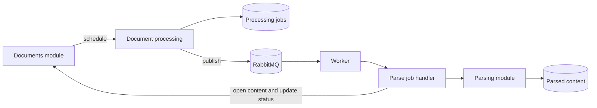
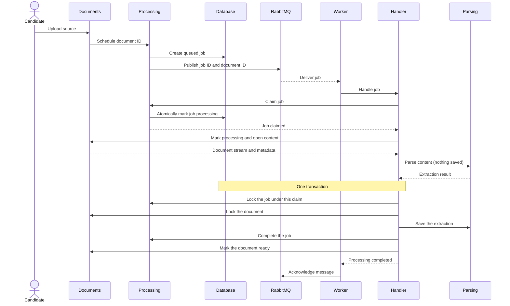
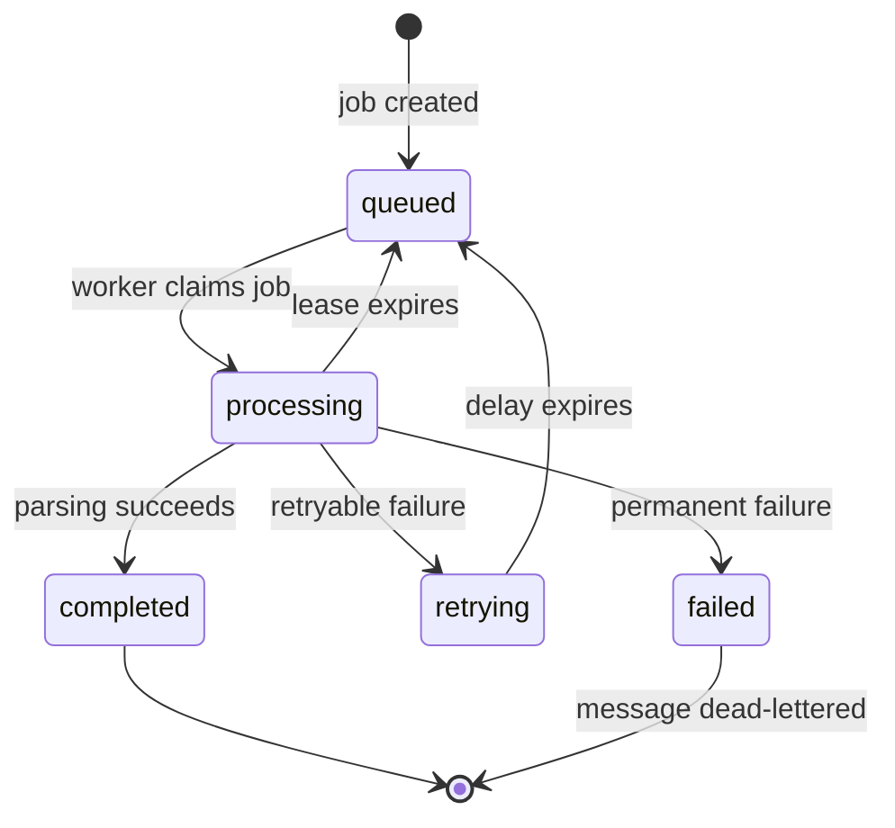
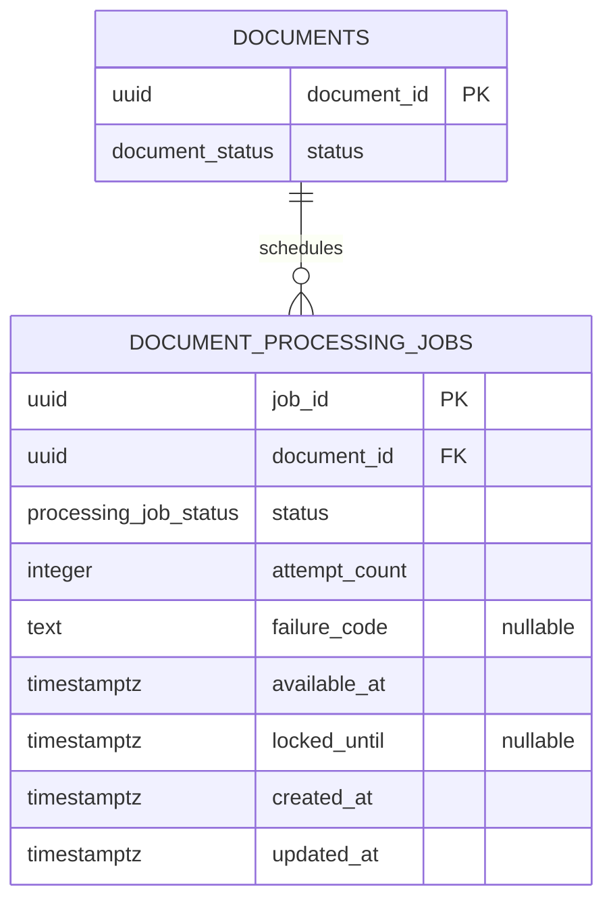

# Asynchronous document processing pipeline

## Goal

Process uploaded source documents asynchronously through RabbitMQ while keeping
storage, parsing, and claim extraction as separate concerns.

## Boundaries

- `documents` owns file storage, metadata, and document lifecycle status.
- `document-processing` owns job scheduling, idempotency, retries, and workflow
  orchestration.
- `parsing` converts PDF or DOCX content into structured text blocks.
- `claim-extraction` later converts parsed blocks into profile claims.
- `infrastructure/messaging` contains RabbitMQ-specific code.
- `workers` compose dependencies and run consumers.

## Implemented structure

```text
src/
├── infrastructure/
│   └── messaging/
│       ├── message-broker.ts
│       ├── messaging.plugin.ts
│       └── rabbitmq.ts
├── modules/
│   ├── document-processing/
│   │   ├── document-processing.table.ts
│   │   ├── document-processing.repository.ts
│   │   ├── document-processing.service.ts
│   │   ├── parse-document.job.ts
│   │   ├── parse-document.handler.ts
│   │   ├── parse-document.message-handler.ts
│   │   └── index.ts
│   └── parsing/
│       └── ...
└── workers/
    ├── document-processing.bootstrap.ts
    ├── document-processing.retry-publisher.ts
    ├── document-processing.worker.ts
    └── main.ts
```

Tests remain beside the implementation they cover.

## Job contract

```ts
interface ParseDocumentJob {
  version: 1;
  jobId: string;
  documentId: string;
}
```

Queue messages must not contain file bytes, storage paths, parsed content, or
profile claims.

The main queue is `document-processing.parse-document`. RabbitMQ declares the
durable companion queue `document-processing.parse-document.dead-letter` and
routes malformed messages and permanent failures there.

## Upload scheduling

When an upload returns a source document that is `stored` or `failed`, new or
deduplicated, the documents upload route calls
`documentProcessingService.schedule(documentId)`. The service persists a
queued job before publishing its versioned message. A document has at most one
active (`queued`, `processing`, or `retrying`) job: scheduling it again returns
that job instead of creating a second one. Evidence documents and source
documents that are `processing`, `ready`, or `deleting` are not scheduled.

Each file in a multipart upload is handled independently. A scheduling failure
is reported for that file without rolling back other successful uploads. The
stored-document write and processing-job publication are not one atomic
operation; an outbox remains the production-hardening step for that guarantee.

## Components



## Successful processing



## Job lifecycle



In the normal failure path, the handler allows three claimed parsing attempts.
Thrown parser errors and extraction results with `status = failed` use the
same failure path; a failed result is still saved. Failures on attempts one
and two move the job to `retrying` for 30 seconds. The current RabbitMQ
delivery is acknowledged after that durable transition; the retry publisher
later releases and republishes the job. A failure on attempt three marks both
the document and job failed and rejects the message without requeueing, which
sends it to the dead-letter queue. `succeeded` and `partial` extractions
complete the job and mark the document ready.

Every claim creates a five-minute processing lease. If a worker exits before
settling the job, the recovery publisher moves the expired `processing` job
back to `queued` and republishes it. Document processing transitions accept an
already-`processing` document so the recovered delivery can resume safely.

## Concurrency and duplicates

The rules below follow the
[duplicate and conflict resolution design](../duplicates-and-conflicts.md).

**One active job per document.** The partial unique index
`document_processing_jobs_active_document_unique` allows one job per document
in `queued`, `processing`, or `retrying`. `createQueuedJob` inserts with
`ON CONFLICT DO NOTHING` and otherwise returns the active job.

**Each claim is fenced by its attempt.** `claimJob` increases `attempt_count`.
The handler keeps the claimed record, and completing, retrying, or failing the
job only matches it while it is still `processing` with that attempt count.
After a lease expires and another worker claims the job, the older attempt
matches nothing and stops with the outcome `stale`.

**An attempt ends in one transaction.** The document is read and parsed outside
any transaction. The attempt then ends in one transaction (the `UnitOfWork` in
`infrastructure/database`) that:

1. locks the job row under this claim (`SELECT … FOR UPDATE`), or stops with
   `stale` without writing anything;
2. locks the document row, so a delete requested now waits for this attempt;
3. saves the extraction, then completes, retries, or fails the job, and marks
   the document `ready` or `failed`.

If any write fails, nothing is saved and the job stays `processing` until its
lease expires. A completed job therefore always has its extraction and a
`ready` document.

**Deleted documents.** When the locked document is gone or `deleting`, the job
is failed with `DOCUMENT_DELETED` and the outcome is `cancelled`; the message is
acknowledged, not dead-lettered. This also applies when the document could not
move to `processing`, so a deleted document never loops through lease
recovery.

**Attempt limit after crashes.** A worker that keeps crashing never reaches the
retry logic, while every lease recovery adds an attempt. A job claimed with an
attempt count above three is failed with `MAX_ATTEMPTS_EXCEEDED` before the
document is read again.

| Outcome | Meaning | Message |
| --- | --- | --- |
| `processed` | Extraction saved, job completed, document ready | Acknowledged |
| `retrying` | Job scheduled for another attempt | Acknowledged |
| `failed` | Job and document failed | Dead-lettered |
| `cancelled` | Document deleted; job failed with `DOCUMENT_DELETED` | Acknowledged |
| `skipped` | Job was not claimable, such as a duplicate delivery | Acknowledged |
| `stale` | Another attempt owns the job; nothing was written | Acknowledged |

## Implemented data model



The processing-job table provides durable idempotency, leasing, and retry state.

## Runtime policy

| Policy | Implemented value |
| --- | ---: |
| Permanent parsing-failure cutoff | Attempt 3 |
| Claims allowed before failing without parsing | 3 |
| Retry delay | 30 seconds |
| Processing lease | 5 minutes |
| Retry and lease-recovery poll interval | 5 seconds |
| Retry release batch | 100 jobs |
| Expired-lease recovery batch | 100 jobs |
| Startup queued-job recovery batch | 100 jobs |
| Worker prefetch / maximum in flight | 1 job |

The retry publisher runs once during worker startup and then schedules the next
cycle only after the active cycle finishes, so cycles cannot overlap. Retry
release and expired-lease recovery log their query and per-job publication
failures independently.

## Worker operation

Run the API and worker as separate processes:

```bash
npm run dev
npm run worker:dev
```

For compiled output, run `npm run build`, then `npm start` and
`npm run worker` in separate processes.

Worker startup waits for application readiness, republishes a bounded batch of
queued jobs, runs an immediate retry/recovery cycle, and then registers the
consumer. `SIGINT` and `SIGTERM` stop future recovery polls, cancel RabbitMQ
consumers, wait for active polling and message handling, and close application
resources.

Structured logs include `jobId`, `documentId`, and the handler outcome for
valid jobs. Invalid payloads are logged without their raw content. Unexpected
handler errors are logged and requeued by the broker.

If `document-processing.parse-document` already exists without dead-letter
arguments, delete that main queue through the RabbitMQ management UI before
restarting the API or worker. It will be recreated with the durable
dead-letter topology; do not delete the dead-letter queue if its messages must
be retained for inspection.

### Enumerations

- `document_status`: `stored`, `processing`, `ready`, `failed`, `deleting`
- `processing_job_status`: `queued`, `processing`, `retrying`, `completed`,
  `failed`

## Requirements

- Publish a versioned job containing only `jobId` and `documentId`.
- Move documents through `stored -> processing -> ready | failed`.
- Claim jobs atomically so duplicate deliveries cannot process concurrently.
- Keep one active job per document and fence every write by the claim's attempt.
- End each attempt in one transaction; never retry a deleted document.
- Use bounded retries followed by dead-lettering.
- Recover jobs abandoned after a worker crash by using a processing lease.
- Support graceful shutdown and structured job logging.
- Use an injected parser interface and a fake parser in processing tests.
- Add an outbox before production if document creation and publication must be
  guaranteed as one operation.
