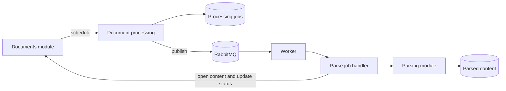
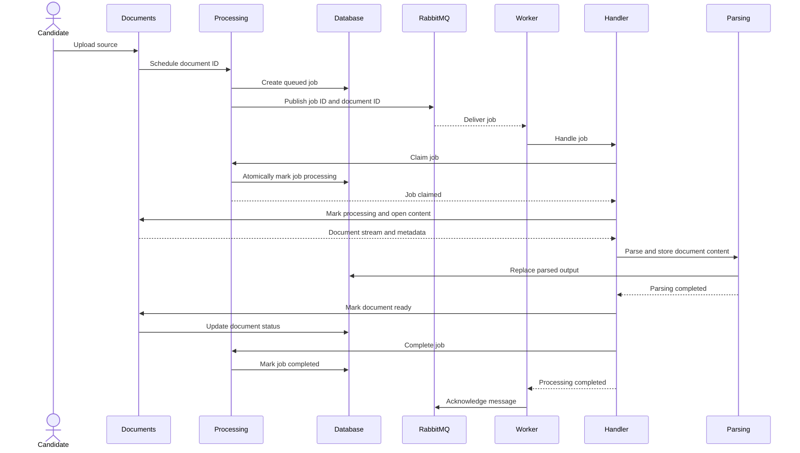
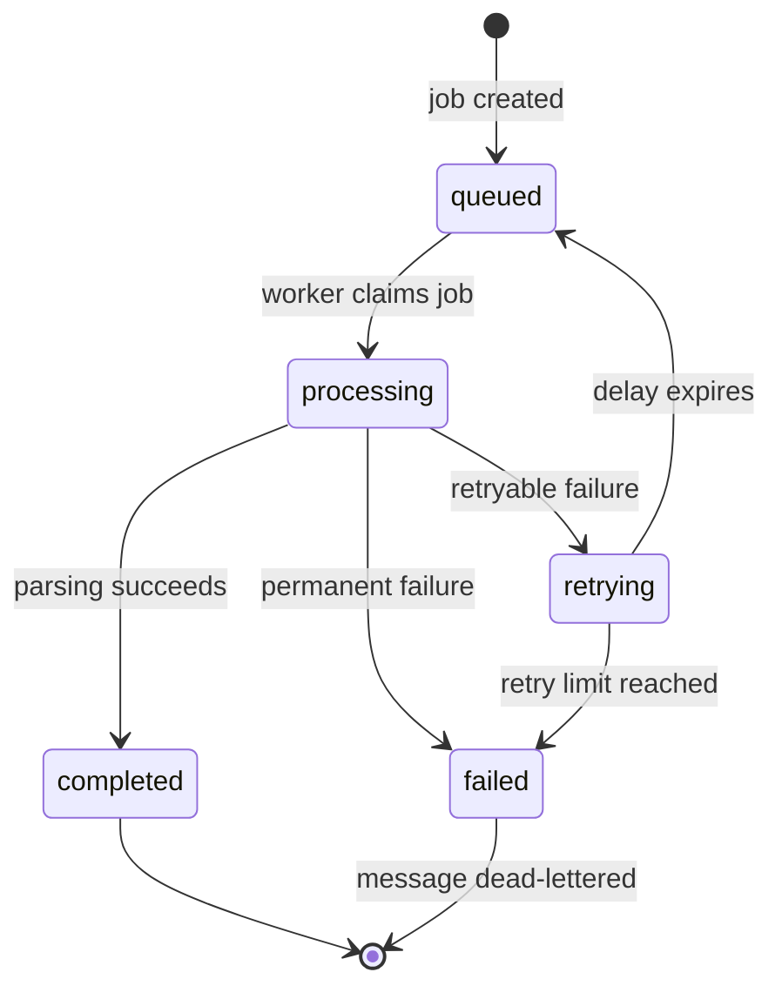
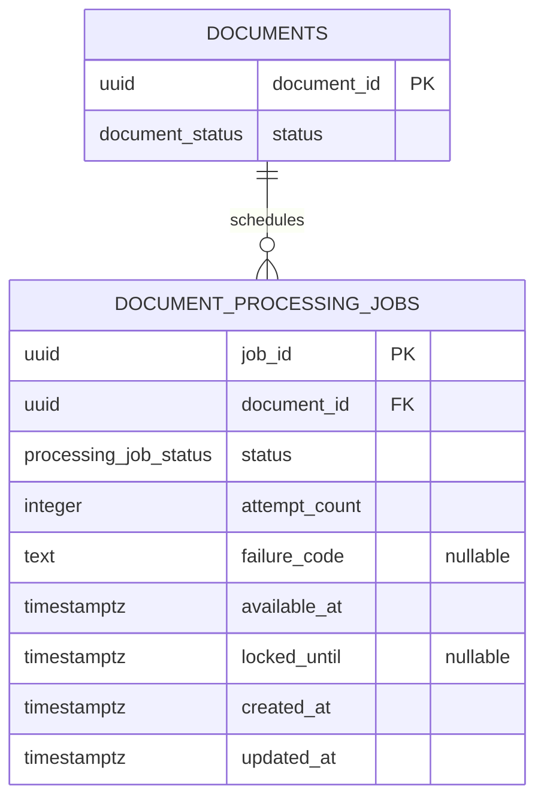

# Asynchronous document processing pipeline

## Goal

Process uploaded source documents asynchronously through RabbitMQ while keeping
storage, parsing, and claim extraction as separate concerns.

## Boundaries

- `documents` owns file storage, metadata, and document lifecycle status.
- `document-processing` owns job scheduling, idempotency, retries, and workflow
  orchestration.
- `parsing` converts PDF or DOCX content into structured text blocks.
- `claim-extraction` later converts parsed blocks into profile claims.
- `infrastructure/messaging` contains RabbitMQ-specific code.
- `workers` compose dependencies and run consumers.

## Proposed structure

```text
src/
├── infrastructure/
│   └── messaging/
│       ├── message-broker.ts
│       └── rabbitmq.ts
├── modules/
│   ├── document-processing/
│   │   ├── document-processing.table.ts
│   │   ├── document-processing.repository.ts
│   │   ├── parse-document.job.ts
│   │   ├── parse-document.handler.ts
│   │   └── index.ts
│   └── parsing/
│       ├── parser.ts
│       ├── parsing.types.ts
│       ├── parsing.table.ts
│       ├── pdf.parser.ts
│       └── docx.parser.ts
└── workers/
    └── main.ts
```

Keep the parsing module flat until additional parser concerns justify
subdirectories.

## Job contract

```ts
interface ParseDocumentJob {
  version: 1;
  jobId: string;
  documentId: string;
}
```

Queue messages must not contain file bytes, storage paths, parsed content, or
profile claims.

## Components



## Successful processing



## Job lifecycle



## Suggested data model



The processing-job table provides durable idempotency, leasing, and retry state.

### Enumerations

- `document_status`: `stored`, `processing`, `ready`, `failed`, `deleting`
- `processing_job_status`: `queued`, `processing`, `retrying`, `completed`,
  `failed`

## Requirements

- Publish a versioned job containing only `jobId` and `documentId`.
- Move documents through `stored -> processing -> ready | failed`.
- Claim jobs atomically so duplicate deliveries cannot process concurrently.
- Use bounded retries followed by dead-lettering.
- Recover jobs abandoned after a worker crash by using a processing lease.
- Support graceful shutdown and structured job logging.
- Use an injected parser interface and a fake parser in processing tests.
- Add an outbox before production if document creation and publication must be
  guaranteed as one operation.

