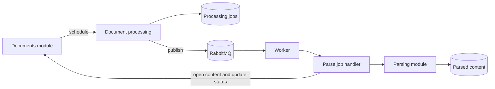
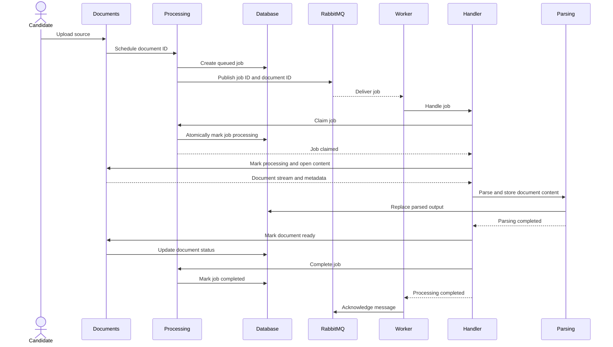
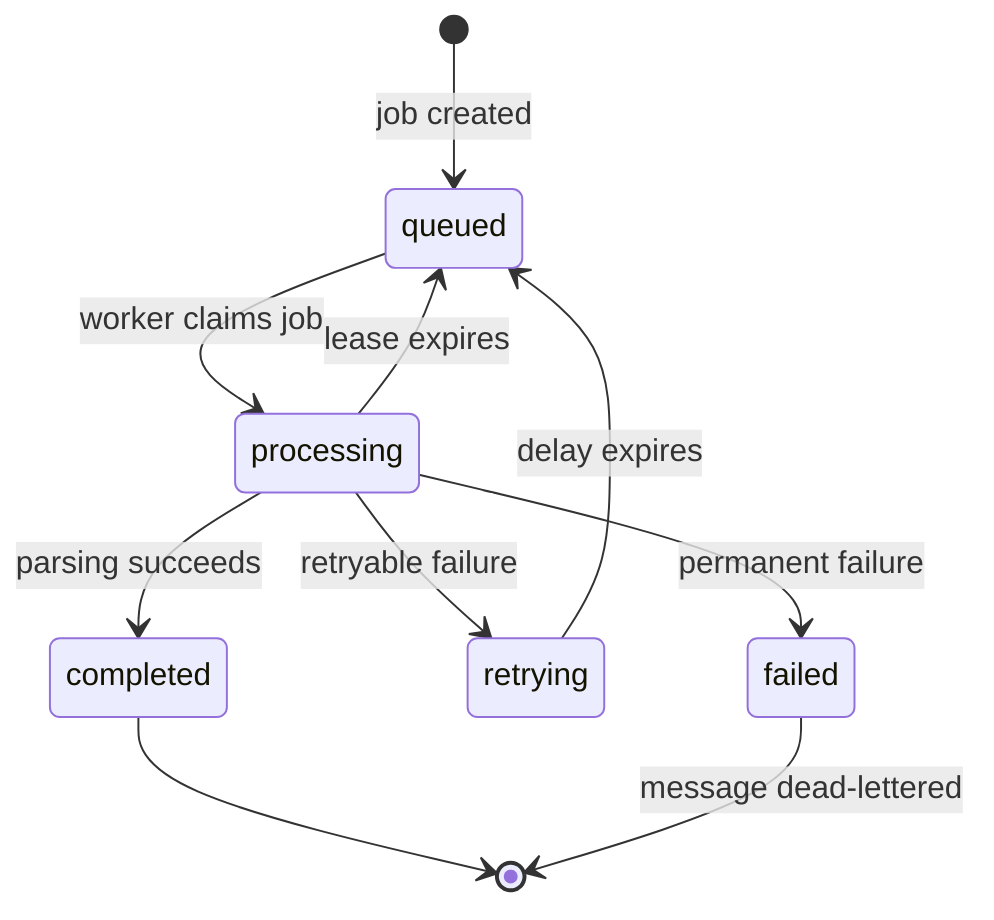
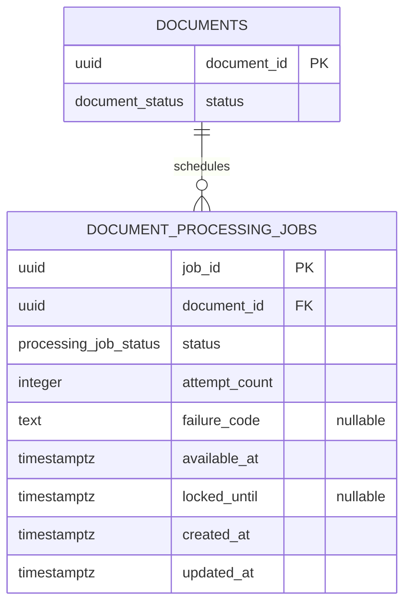

# Asynchronous document processing pipeline

## Goal

Process uploaded source documents asynchronously through RabbitMQ while keeping
storage, parsing, and claim extraction as separate concerns.

## Boundaries

- `documents` owns file storage, metadata, and document lifecycle status.
- `document-processing` owns job scheduling, idempotency, retries, and workflow
  orchestration.
- `parsing` converts PDF or DOCX content into structured text blocks.
- `claim-extraction` later converts parsed blocks into profile claims.
- `infrastructure/messaging` contains RabbitMQ-specific code.
- `workers` compose dependencies and run consumers.

## Implemented structure

```text
src/
├── infrastructure/
│   └── messaging/
│       ├── message-broker.ts
│       ├── messaging.plugin.ts
│       └── rabbitmq.ts
├── modules/
│   ├── document-processing/
│   │   ├── document-processing.table.ts
│   │   ├── document-processing.repository.ts
│   │   ├── document-processing.service.ts
│   │   ├── parse-document.job.ts
│   │   ├── parse-document.handler.ts
│   │   ├── parse-document.message-handler.ts
│   │   └── index.ts
│   └── parsing/
│       └── ...
└── workers/
    ├── document-processing.bootstrap.ts
    ├── document-processing.retry-publisher.ts
    ├── document-processing.worker.ts
    └── main.ts
```

Tests remain beside the implementation they cover.

## Job contract

```ts
interface ParseDocumentJob {
  version: 1;
  jobId: string;
  documentId: string;
}
```

Queue messages must not contain file bytes, storage paths, parsed content, or
profile claims.

The main queue is `document-processing.parse-document`. RabbitMQ declares the
durable companion queue `document-processing.parse-document.dead-letter` and
routes malformed messages and permanent failures there.

## Upload scheduling

After a source document is stored successfully, the documents upload route
calls `documentProcessingService.schedule(documentId)`. The service persists a
queued job before publishing its versioned message. Evidence documents and
deduplicated source uploads do not create another processing job.

Each file in a multipart upload is handled independently. A scheduling failure
is reported for that file without rolling back other successful uploads. The
stored-document write and processing-job publication are not one atomic
operation; an outbox remains the production-hardening step for that guarantee.

## Components



## Successful processing



## Job lifecycle



In the normal failure path, the handler allows three claimed parsing attempts.
Failures on attempts one and two move the job to `retrying` for 30 seconds. The
current RabbitMQ delivery is acknowledged after that durable transition; the
retry publisher later releases and republishes the job. A failure on attempt
three or later marks both the document and job failed and rejects the message
without requeueing, which sends it to the dead-letter queue.

Every claim creates a five-minute processing lease. If a worker exits before
settling the job, the recovery publisher moves the expired `processing` job
back to `queued` and republishes it. Document processing transitions accept an
already-`processing` document so the recovered delivery can resume safely.

## Implemented data model



The processing-job table provides durable idempotency, leasing, and retry state.

## Runtime policy

| Policy | Implemented value |
| --- | ---: |
| Permanent parsing-failure cutoff | Attempt 3 or later |
| Retry delay | 30 seconds |
| Processing lease | 5 minutes |
| Retry and lease-recovery poll interval | 5 seconds |
| Retry release batch | 100 jobs |
| Expired-lease recovery batch | 100 jobs |
| Startup queued-job recovery batch | 100 jobs |
| Worker prefetch / maximum in flight | 1 job |

The retry publisher runs once during worker startup and then schedules the next
cycle only after the active cycle finishes, so cycles cannot overlap. Retry
release and expired-lease recovery log their query and per-job publication
failures independently.

## Worker operation

Run the API and worker as separate processes:

```bash
npm run dev
npm run worker:dev
```

For compiled output, run `npm run build`, then `npm start` and
`npm run worker` in separate processes.

Worker startup waits for application readiness, republishes a bounded batch of
queued jobs, runs an immediate retry/recovery cycle, and then registers the
consumer. `SIGINT` and `SIGTERM` stop future recovery polls, cancel RabbitMQ
consumers, wait for active polling and message handling, and close application
resources.

Structured logs include `jobId`, `documentId`, and the handler outcome for
valid jobs. Invalid payloads are logged without their raw content. Unexpected
handler errors are logged and requeued by the broker.

If `document-processing.parse-document` already exists without dead-letter
arguments, delete that main queue through the RabbitMQ management UI before
restarting the API or worker. It will be recreated with the durable
dead-letter topology; do not delete the dead-letter queue if its messages must
be retained for inspection.

### Enumerations

- `document_status`: `stored`, `processing`, `ready`, `failed`, `deleting`
- `processing_job_status`: `queued`, `processing`, `retrying`, `completed`,
  `failed`

## Requirements

- Publish a versioned job containing only `jobId` and `documentId`.
- Move documents through `stored -> processing -> ready | failed`.
- Claim jobs atomically so duplicate deliveries cannot process concurrently.
- Use bounded retries followed by dead-lettering.
- Recover jobs abandoned after a worker crash by using a processing lease.
- Support graceful shutdown and structured job logging.
- Use an injected parser interface and a fake parser in processing tests.
- Add an outbox before production if document creation and publication must be
  guaranteed as one operation.
