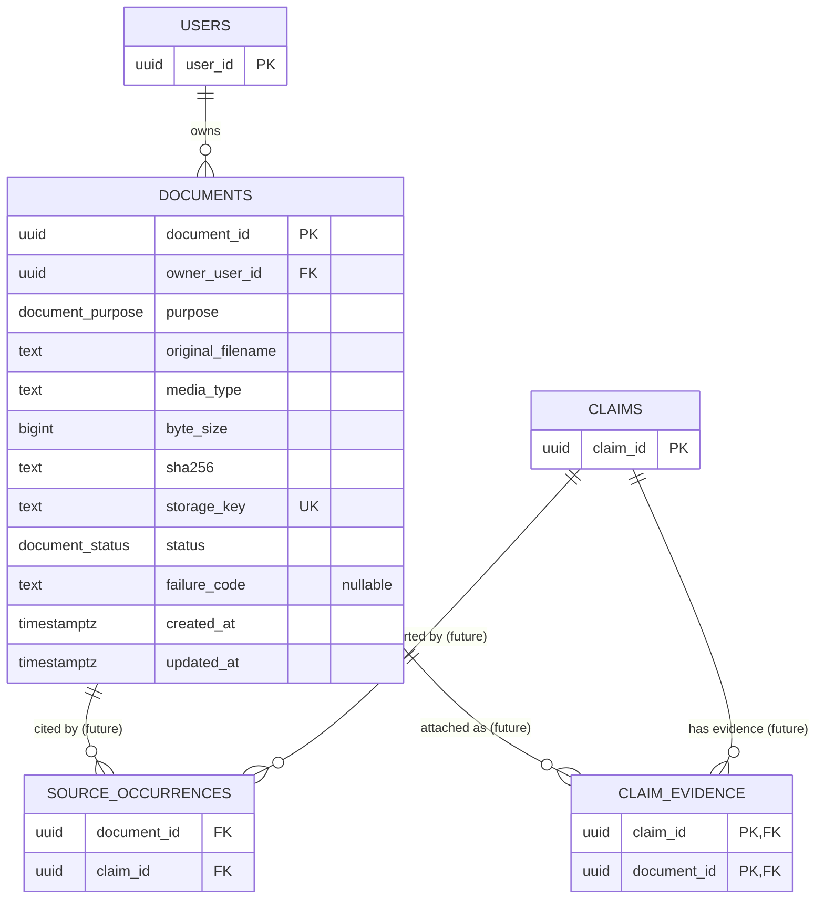
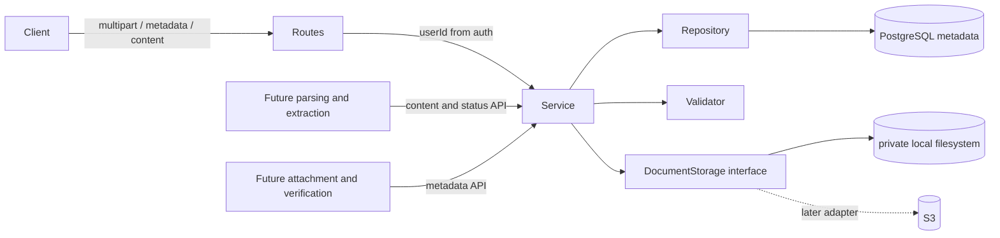
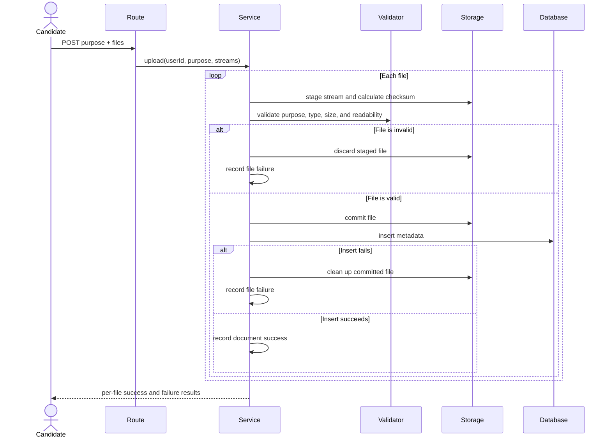
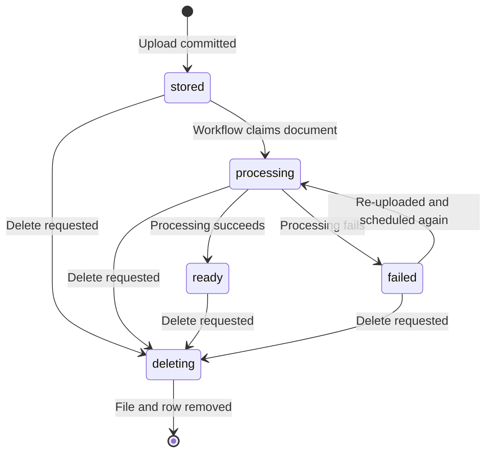

# Document upload module plan

## Goal

Use one `documents` module to upload, store, list, download, and delete all
candidate-owned source and evidence documents.

## Scope

- Store files on a private local filesystem; keep metadata in PostgreSQL.
- Accept PDF/DOCX sources and PDF/DOCX/JPEG/PNG evidence.
- Support single and multi-file uploads, authenticated downloads, and deletion.
- Leave parsing, extraction, claim attachment, and verification to later modules.

## Design decisions

- Use one `documents` table with `purpose = source | evidence`.
- Derive ownership from the authenticated user; never accept an owner ID.
- Store only the server-verified `media_type`; discard the client MIME type.
- Stream files with hard size/count limits and validate their actual content type.
- Keep original bytes; use an opaque storage key and SHA-256 checksum.
- Deduplicate identical content per owner and purpose by SHA-256, returning the
  existing document instead of storing another object.
- Use a `DocumentStorage` adapter to hide filesystem details and simplify a
  future transition to S3.
- Send upload `purpose` as a required query parameter because it applies to the
  entire file batch. This avoids repeating batch metadata in multipart fields
  and allows the request purpose to be validated before processing file streams.
- Process every uploaded file independently; one failure does not roll back
  successful files from the same request.
- Keep workflow-specific metadata in later one-to-one tables, not `documents`.

## API

All routes require an active candidate account and scope queries by authenticated
`userId` plus `documentId`.

| Method | Endpoint | Action |
| --- | --- | --- |
| `POST` | `/api/candidates/me/documents?purpose=source` | Upload one or more `file` parts with a required purpose query |
| `GET` | `/api/candidates/me/documents` | List; filter by `purpose` or `status` |
| `GET` | `/api/candidates/me/documents/:documentId` | Read metadata |
| `GET` | `/api/candidates/me/documents/:documentId/content` | Stream original bytes |
| `DELETE` | `/api/candidates/me/documents/:documentId` | Delete document |

The upload response reports a success or failure for each file so clients can
retry only failed files. If a request exceeds the configured file-count limit,
the API keeps the first permitted files and returns `207 Multi-Status` with
`limit.reached = true`; later file parts are rejected by the multipart parser.
An upload matching an existing owner, purpose, and SHA-256 returns that document
with `deduplicated: true` instead of creating another row or storage object.

An upload matching a document that is being deleted fails for that file with
`409 DOCUMENT_BEING_DELETED`, instead of returning a document about to
disappear. Deleting is idempotent: when two deletes of the same document run
at once, the one that finds the row already removed also returns `204`.

A source document is scheduled for processing whenever an upload returns it
`stored` or `failed`, new or deduplicated. Re-uploading therefore schedules a
document whose earlier scheduling failed or whose processing failed. Scheduling
twice is harmless: a document has at most one active processing job. See
[Document processing](document-processing.md).

## Validation and integrity requirements

Reject a file before committing it to storage when any upload requirement
fails:

- `original_filename` must be at most 255 Unicode characters and contain at
  least one non-whitespace character. Preserve the accepted filename exactly
  as received; use the opaque `storage_key` for filesystem access.
- Files must be nonempty and must not exceed the configured upload-size limit.
- Determine the media type from the file contents; do not trust the multipart
  content type or filename extension.
- Source documents accept only PDF and DOCX. Evidence documents accept PDF,
  DOCX, JPEG, and PNG.
- Files must be readable and structurally valid for their detected media type.

PostgreSQL enforces stable metadata invariants even when a write does not pass
through the upload validator:

- `owner_user_id`, `purpose`, `original_filename`, `media_type`, `byte_size`,
  `sha256`, `storage_key`, and `status` are required.
- `byte_size` is greater than zero.
- `sha256` is exactly 64 lowercase hexadecimal characters.
- `storage_key` contains at least one non-whitespace character and is unique.
- `media_type` is one of the supported server-verified values and is compatible
  with the document purpose.
- `failure_code` is required exactly when `status = failed` and is otherwise
  null.
- Deleting a user cascades to that user's document metadata.

## Data model

- `document_purpose`: `source`, `evidence`
- `document_status`: `stored`, `processing`, `ready`, `failed`, `deleting`
- `media_type`: server-verified media type; no separate `mime_type` column
- Index `(owner_user_id, created_at)`; make `storage_key` and
  `(owner_user_id, purpose, sha256)` unique.

## Module boundaries

## Upload flow

## Lifecycle

A processing attempt locks the document while it finishes, so a delete
requested at that moment waits for it. A document that is deleted or being
deleted ends its processing job with `DOCUMENT_DELETED` instead of being
retried.

Once a document is `deleting`, the pending claims extracted from it that the
candidate never edited or merged, and that no other document supports, are
deleted with it, so the review list holds no suggestions without a source.
Accepted and candidate-edited claims stay. Review items and source occurrences
of the document cascade with its row. Cleanup of documents left in `deleting`
repeats this step.

## Implementation

### Implemented

- [x] Validate the private storage root, per-file byte limit, and per-request
  file-count limit from environment configuration.
- [x] Persist document metadata in the `documents` table with migrations,
  database constraints, indexes, and central schema export.
- [x] Stage and hash uploads while streaming without loading complete files into
  application memory.
- [x] Detect supported media types from file content, enforce purpose/type
  compatibility, and perform lightweight signature and marker validation.
- [x] Commit staged files atomically using opaque UUID storage keys that cannot
  escape the private storage root.
- [x] Discard staged files and delete committed files idempotently.
- [x] Upload one or more files with independent success or failure results.
- [x] Prevent duplicate content per owner and purpose, including concurrent
  uploads, and clean up the losing request's staged or committed object.
- [x] Keep files up to the configured per-request count limit and report
  multipart overflow as a partial `207 Multi-Status` result.
- [x] List owned document metadata with optional purpose and status filters.
- [x] Read metadata and stream original file bytes through authenticated,
  owner-scoped endpoints.
- [x] Delete an owned document by marking it `deleting`, removing its stored
  bytes, and then deleting its metadata.
- [x] Retry cleanup of documents left in `deleting` status when the application
  starts, continuing past individual storage failures.
- [x] Remove UUID-named staging files older than the configured maximum age when
  the application starts, without touching recent uploads.
- [x] Reconcile old committed objects with database storage keys at application
  startup and remove unreferenced objects after a configurable grace period.
- [x] Cover storage, validation, service, route, and table behavior with focused
  automated tests and manual HTTP requests.

### Not yet implemented

- [ ] Replace lightweight marker checks with parser-backed validation that
  establishes that PDF, DOCX, JPEG, and PNG files are genuinely readable.
- [ ] Reconcile multipart size-limit errors with per-file batch results.
- [ ] Remove filesystem objects immediately when account deletion cascades
  document rows instead of waiting for orphan cleanup.
- [ ] Identify dependent profile claims and explain their impact before deleting
  a source document.
- [ ] Add claim evidence attachment, reuse, detachment, and dependent cleanup.
- [ ] Accept supported LinkedIn data exports as candidate sources.
- [ ] Automatically initiate parsing for valid source uploads and implement the
  `stored` → `processing` → `ready` or `failed` lifecycle.
- [ ] Extract certificate metadata and connect source occurrences to claims.
- [ ] Expose only narrow document-service operations to later parsing and
  evidence modules.

## Verification

- [ ] Test authentication, ownership, both purposes, filters, limits, and mixed per-file upload outcomes.
- [ ] Test disguised, corrupt, empty, oversized, and purpose/type-mismatched files.
- [ ] Test blank, 255-character, and 256-character original filenames.
- [ ] Test byte-for-byte download, checksum, cleanup, and idempotent deletion.
- [ ] Test database constraints, indexes, ordering, and account-delete cascade.
- [ ] Run focused tests, `npm test`, and `npm run build`.
