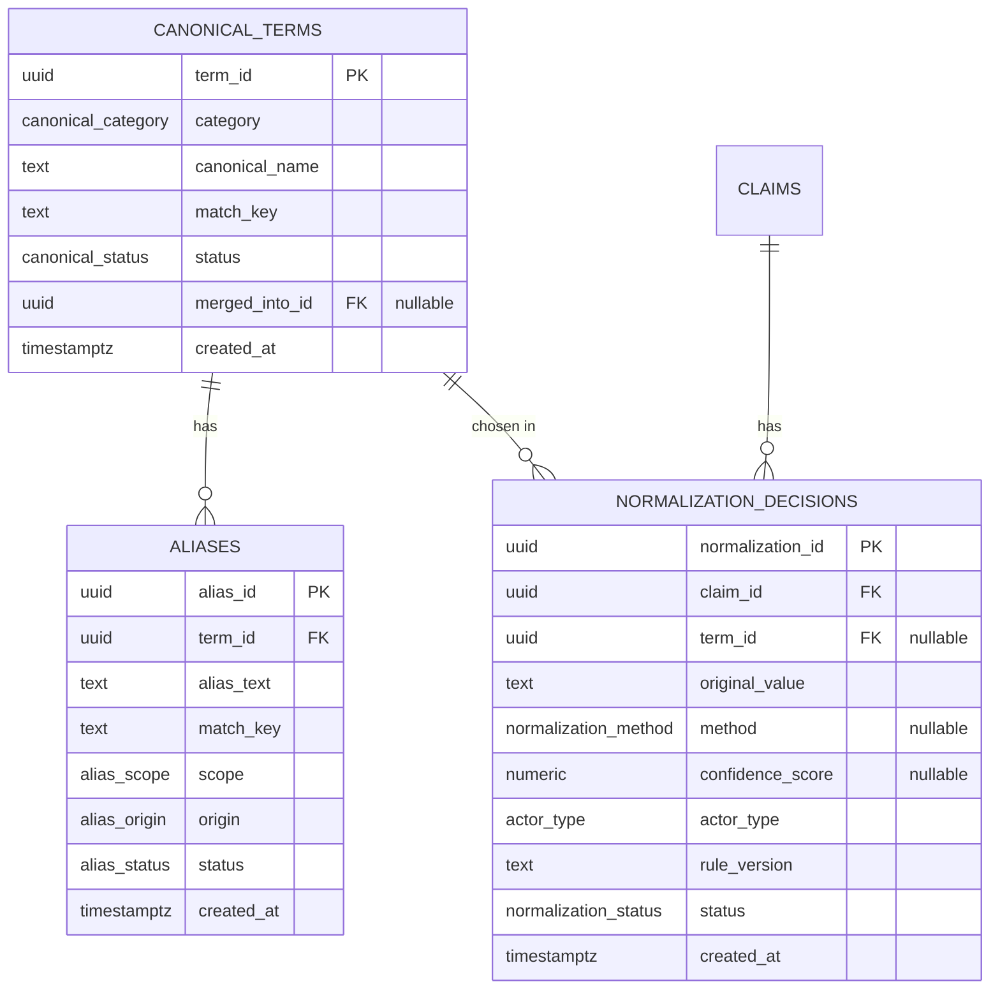
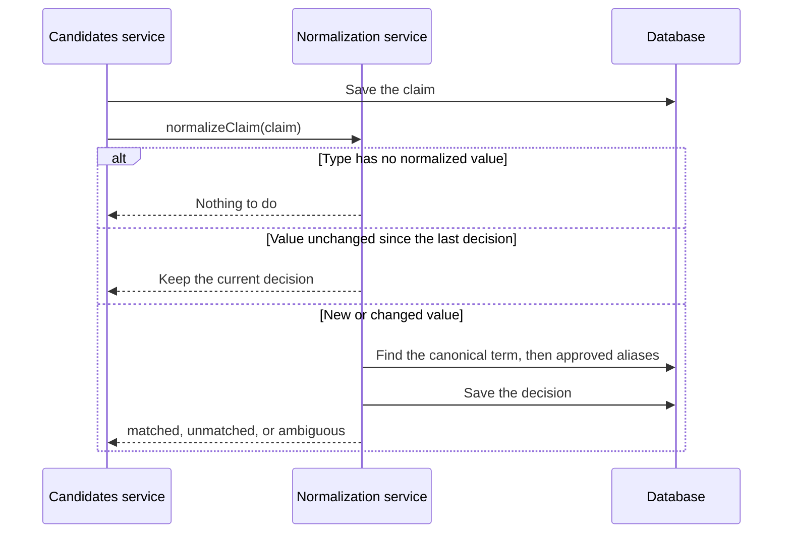

# Canonical term and alias normalization plan (V1)

## Goal

Candidates write the same thing in different ways: "JS", "Javascript", and
"JavaScript" are one skill. Normalization links a claim's value to one
canonical term, so equivalent values are recognized, while the value the
candidate or CV wrote stays exactly as it is.

V1 covers exact matching against a curated dictionary. Fuzzy matching, AI
matching, candidate choices, and reviewer approval come later.

## Scope

- Normalize three kinds of values, one per claim:

| Claim type | Value normalized | Category |
| --- | --- | --- |
| `skill` | `name` | `skill` |
| `employment` | `jobTitle` | `job_title` |
| `education` | `degree` | `degree` |

- Other claim types and fields are not normalized in V1, including the
  `skills` lists inside employment and project claims, certifications, and
  institutions. Institutions are excluded by FR-AN-01.
- Claim values are never changed. The result is stored as a separate
  normalization decision.

## Matching

Values are compared by a **match key**: the text in Unicode NFKC form, with
surrounding spaces removed, inner spaces collapsed, and letters in lowercase.
Punctuation is kept, because it carries meaning in skills such as `C++`,
`C#`, and `Node.js`.

| Written value | Match key |
| --- | --- |
| `  JavaScript ` | `javascript` |
| `Back End  Developer` | `back end developer` |
| `C#` | `c#` |

Matching follows the first two steps of FR-AN-02 and stops at the first match:

1. **Canonical term:** an active canonical term in the same category whose
   name has the same match key.
2. **Approved alias:** an approved global alias in the same category with the
   same match key, pointing to an active canonical term.

| Situation | Decision status | Term | Method |
| --- | --- | --- | --- |
| One canonical term matches | `matched` | That term | `canonical` |
| No canonical term, one term through aliases | `matched` | That term | `alias` |
| Aliases point to more than one term | `ambiguous` | None | `alias` |
| Nothing matches | `unmatched` | None | None |

- A merged term is followed to the active term it was merged into.
- Ambiguous and unmatched values are left unchanged for candidate review
  (FR-AN-03). Nothing is guessed.
- An exact match has a confidence of `1`. Unmatched and ambiguous decisions
  have no confidence.

## Data model

The `normalization` module owns three tables, a first version of the ERD's
`CanonicalTerm`, `Alias`, and `NormalizationDecision`.



- `canonical_terms`: one row per term. A term's `(category, match_key)` is
  unique.
- `aliases`: another way to write a term. An alias's `(term_id, match_key)` is
  unique. Aliases are found by `(match_key)`.
- `normalization_decisions`: one row per normalization of a claim, with the
  value it normalized. Decisions cascade on claim deletion. The newest
  decision of a claim is the current one; older ones are its history
  (FR-AN-07).

### Enumerations

| Enumeration | Values | Used in V1 |
| --- | --- | --- |
| `canonical_category` | `skill`, `job_title`, `degree` | All |
| `canonical_status` | `active`, `merged` | All |
| `alias_scope` | `global`, `candidate` | `global` |
| `alias_origin` | `seed`, `ai`, `candidate`, `reviewer` | `seed` |
| `alias_status` | `pending`, `approved`, `rejected` | `approved` |
| `normalization_method` | `canonical`, `alias`, `fuzzy`, `ai`, `candidate` | `canonical`, `alias` |
| `normalization_status` | `matched`, `unmatched`, `ambiguous` | All |
| `actor_type` | `system`, `ai`, `candidate`, `reviewer` | `system` |

Values that V1 does not use are defined now, so the later steps of FR-AN-02
to FR-AN-05 add behavior without changing the enumerations.

## Flow



- A claim created or changed through the candidate service is normalized now.
  Routing newly persisted extracted claims through this same boundary is the
  next integration step; extraction must not read dictionary tables directly.
- The claim is saved first. If normalization fails, the claim stays without a
  decision and is treated as unmatched; it can be normalized again later.
- The candidates module calls the normalization service through a narrow
  interface; it does not read the dictionary tables.

## Starting dictionary

A starting dictionary of common skills, job titles, and degrees, with their
common spellings as aliases, lives in `normalization.seed-data.ts`: 96 terms
(66 skills, 21 job titles, and 10 degrees) and 104 aliases. Load it with:

```bash
npm run normalization:seed
```

The command uses the same environment variables as the API. Its terms and
aliases are `active`, `approved`, `global`, and `seed`. Running the command
again adds only what is missing, so the dictionary can grow without changing
existing rows. Tests check that no term is written twice in a category, that
no alias belongs to two terms, and that no alias is another term's name.

Aliases in the starting dictionary only cover different ways of writing the
same thing, such as `JS` for `JavaScript` or `BSc` for `Bachelor of Science`.
Different things that are merely related, such as `Backend Engineer` and
`Backend Developer`, are left to later review.

## Decisions

1. **Exact matching only.** V1 links a value only when it is certainly the
   same term. A wrong link would change what the profile claims, so fuzzy and
   AI matching wait for candidate review and reviewer approval.
2. **Claim values are never changed.** The original value is the evidence; the
   canonical term is stored beside it as a decision.
3. **A new decision for every change.** Decisions are not overwritten, so the
   normalization history is kept.
4. **Punctuation is part of the match key.** `C`, `C#`, and `C++` are
   different skills.
5. **The card's three categories only.** Certifications, named in FR-AN-01, are
   left for later, as the task limits V1 to skills, job titles, and degrees.

## Revisit later

Listed under "Revisit later" on the task:

- Fuzzy matching and spelling correction.
- AI contextual matching and dictionary proposals.
- Candidate-specific aliases and candidate resolution.
- Human review and global approval of proposed terms or aliases.
- Rechecking unmatched values when the dictionary changes (FR-AN-06).
- Consolidating duplicate claims after normalization.
- Letting the AI agent propose new canonical terms and aliases for review.

Also later: normalizing the `skills` lists inside employment and project
claims, certifications, and showing canonical terms in the profile API and
export.
