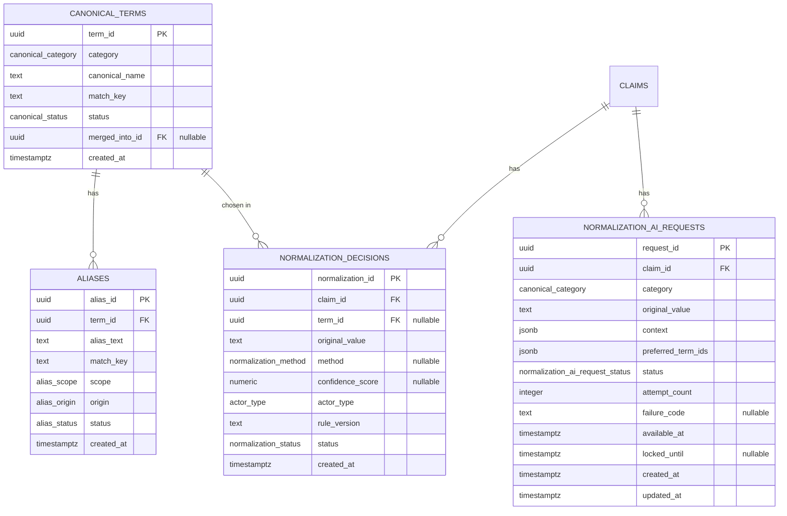
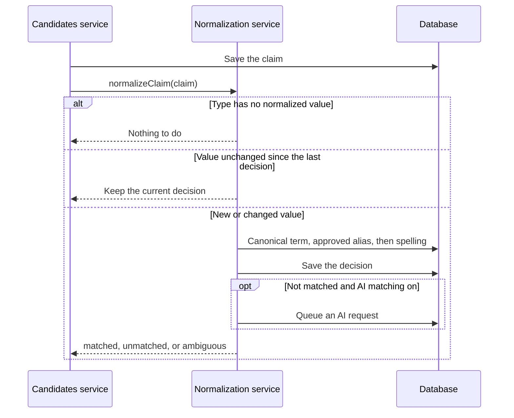

# Canonical term and alias normalization

## Goal

Candidates write the same thing in different ways: "JS", "Javascript", and
"JavaScript" are one skill. Normalization links a claim's value to one
canonical term, so equivalent values are recognized, while the value the
candidate or CV wrote stays exactly as it is.

Matching follows FR-AN-02 up to the AI step: exact canonical term, approved
alias, spelling correction, then AI contextual matching in the background.
Candidate choices and reviewer approval come later.

## Scope

- Normalize three kinds of values, one per claim:

| Claim type | Value normalized | Category |
| --- | --- | --- |
| `skill` | `name` | `skill` |
| `employment` | `jobTitle` | `job_title` |
| `education` | `degree` | `degree` |

- Other claim types and fields are not normalized yet, including the `skills`
  lists inside employment and project claims, certifications, and
  institutions. Institutions are excluded by FR-AN-01.
- Claim values are never changed. The result is stored as a separate
  normalization decision.

## Matching

Values are compared by a **match key**: the text in Unicode NFKC form, with
surrounding spaces removed, inner spaces collapsed, and letters in lowercase.
Punctuation is kept, because it carries meaning in skills such as `C++`,
`C#`, and `Node.js`.

| Written value | Match key |
| --- | --- |
| `  JavaScript ` | `javascript` |
| `Back End  Developer` | `back end developer` |
| `C#` | `c#` |

Matching stops at the first step that decides:

1. **Canonical term:** a term in the same category whose name has the same
   match key.
2. **Approved alias:** an approved global alias in the same category with the
   same match key.
3. **Spelling correction (`fuzzy`):** the closest canonical name or approved
   alias of the category, within the edits allowed below.
4. **AI (`ai`):** in the background, for values the first three steps leave
   unmatched or ambiguous. See [AI matching](#ai-matching).

| Situation | Decision status | Term | Method | Confidence |
| --- | --- | --- | --- | --- |
| One canonical term matches | `matched` | That term | `canonical` | `1` |
| One term through aliases | `matched` | That term | `alias` | `1` |
| Aliases point to more than one term | `ambiguous` | None | `alias` | None |
| One clearly closest spelling | `matched` | That term | `fuzzy` | Share of the value not edited, such as `0.83` |
| Two terms nearly as close | `ambiguous` | None | `fuzzy` | None |
| Nothing matches | `unmatched` | None | None | None |

A merged term is followed to the active term it was merged into, at every step.

### Spelling correction

Spelling correction fixes typing mistakes only. It counts edits: inserting,
deleting, or changing a letter, or swapping two neighboring letters ("Pyhton").
The number of edits allowed grows with the length of the value:

| Value length | Edits allowed | Example |
| --- | --- | --- |
| Under 6 characters | None (exact only) | `Shift` is not corrected to `Swift` |
| 6 to 9 | 1 | `Pyhton` → `Python` |
| 10 to 15 | 2 | `Javascirpt` → `JavaScript` |
| 16 or more | 3 | `Sofware Enginer` → `Software Engineer` |

Spellings shorter than 6 characters are never correction targets, so a long
value never becomes a short term, such as `Golang` becoming `Go`.

**Clearly closest.** The best term must be at least two edits closer than any
other term; otherwise the decision is `ambiguous` and the AI decides with the
claim's context. The starting dictionary has real pairs one or two edits
apart, where a value between them is not a typo of either:

| Pair | Edits apart |
| --- | --- |
| `Next.js` and `NestJS` | 1 |
| `MySQL` and `MS SQL` | 1 |
| `B.Eng.` and `M.Eng.` | 1 |
| `Project Manager` and `Product Manager` | 2 |
| `ML Engineer` and `QA Engineer` | 2 |

So `Prodject Manager` stays ambiguous, while `ML Enginer` (one edit from
`ML Engineer`, three from `QA Engineer`) is corrected.

## AI matching

A value that the first three steps leave unmatched or ambiguous gets an AI
request. The AI runs in the background, so saving a claim never waits for it.

```mermaid
sequenceDiagram
    participant Candidates as Candidates service
    participant Normalization as Normalization service
    participant Database
    participant Worker
    participant AI as Gemini

    Candidates->>Normalization: normalizeClaim(claim)
    Normalization->>Database: Save the exact or spelling decision
    Normalization->>Database: Queue an AI request with the claim's context
    Normalization-->>Candidates: unmatched or ambiguous, for now
    Worker->>Database: Claim due requests (FOR UPDATE SKIP LOCKED)
    alt An earlier AI match proposed a term for this spelling
        Worker->>Worker: Reuse it, without asking the AI
    else
        Worker->>AI: Value, context, and numbered active terms
        AI-->>Worker: Chosen number, confidence, and reason
    end
    Note over Worker,Database: One transaction
    Worker->>Database: Lock the request; check the value did not change
    Worker->>Database: Save the AI decision
    Worker->>Database: Propose a pending alias when matched
    Worker->>Database: Complete the request
```

**What the AI receives.** The kind of value, the value, the claim's other
fields as context (each cut to 300 characters), and the category's active
terms as a numbered list. Terms that spelling matching found equally close
come first. Every call is recorded in `llm_invocations`, with the claim ID as
its operation ID.

**What is accepted.** The AI returns a term number, or `0` for none, a
confidence, and a one-sentence reason.

| AI output | Result |
| --- | --- |
| A listed number with confidence `0.85` or more | `matched`, method `ai`, actor `ai`, that confidence |
| `0`, or confidence below `0.85` | `unmatched`, method `ai`, actor `ai` |
| Invalid output, or a number outside the list | Request `failed` with `invalid_output`; no decision |

The AI can only choose an existing term; it never creates one. Its prompt asks
for the same concept written differently, never a broader or related one:
`React` is never `JavaScript`.

**Proposed aliases.** A match adds the value as a global alias with origin
`ai` and status `pending`. Exact matching ignores it until a reviewer approves
it (FR-AN-04), but the next request for the same spelling reuses it instead of
asking the AI again (FR-AN-05).

**Stale requests.** A request is only applied while the claim's newest
decision still has the request's value and is not `matched`. Otherwise it is
marked `superseded` and nothing is written. Editing a claim's value supersedes
its active request and queues a new one.

**Failures.**

| Failure | Handling |
| --- | --- |
| Rate limited, timeout, or provider unavailable | Retried after 30 seconds times the attempt number, up to 3 attempts, then `failed` |
| Authentication, configuration, or invalid request | `failed` at once |
| Any other error, such as a database or programming error | Thrown and logged with its real cause; the request is claimed again after its lease |
| The worker stops during a request | Claimed again after its 2-minute lease expires |
| Claimed more than 3 times | `failed` with `max_attempts_exceeded` before the AI is asked |

Only the provider failures above enter the retry policy, so an unexpected
error is never recorded as a provider outage. Every claim adds an attempt, so
requests that keep failing unexpectedly, or keep crashing the worker, still end.

The worker claims one request at a time, up to
`NORMALIZATION_AI_BATCH_SIZE` per cycle, so each 2-minute lease starts when its
request is processed and never expires while waiting behind others. Writes
check the request's attempt number, so a worker whose lease expired cannot
overwrite the work of the worker that took over.

**Running it.** The document-processing worker (`npm run worker`) also
processes AI requests. AI matching is on when `NORMALIZATION_AI_ENABLED` is not
`false` and `LLM_API_KEY` is set; without a key, values that exact and
spelling matching cannot link stay for the candidate, and no requests are
queued.

## Data model



- `canonical_terms`: one row per term. A term's `(category, match_key)` is
  unique.
- `aliases`: another way to write a term. An alias's `(term_id, match_key)` is
  unique. Aliases are found by `(match_key)`.
- `normalization_decisions`: one row per normalization of a claim, with the
  value it normalized. Decisions cascade on claim deletion. The newest
  decision of a claim is the current one; older ones are its history
  (FR-AN-07). `rule_version` is `fuzzy-v1` for exact and spelling decisions
  and `normalization-match-v1` (the AI prompt version) for AI decisions.
- `normalization_ai_requests`: values waiting for the AI. A claim has at most
  one active (`queued` or `processing`) request, enforced by a partial unique
  index. Requests cascade on claim deletion.

### Enumerations

| Enumeration | Values | Used |
| --- | --- | --- |
| `canonical_category` | `skill`, `job_title`, `degree` | All |
| `canonical_status` | `active`, `merged` | All |
| `alias_scope` | `global`, `candidate` | `global` |
| `alias_origin` | `seed`, `ai`, `candidate`, `reviewer` | `seed`, `ai` |
| `alias_status` | `pending`, `approved`, `rejected` | `approved`, `pending` |
| `normalization_method` | `canonical`, `alias`, `fuzzy`, `ai`, `candidate` | All but `candidate` |
| `normalization_status` | `matched`, `unmatched`, `ambiguous` | All |
| `actor_type` | `system`, `ai`, `candidate`, `reviewer` | `system`, `ai` |
| `normalization_ai_request_status` | `queued`, `processing`, `completed`, `failed`, `superseded` | All |

## Flow



- Claims are normalized when the candidate creates or edits them and when an
  extracted claim is reviewed.
- The claim is saved first. If normalization fails, the claim stays without a
  decision and is treated as unmatched; it can be normalized again later.
- Other modules call the normalization service through a narrow interface;
  they do not read the dictionary tables.

## Starting dictionary

A starting dictionary of common skills, job titles, and degrees, with their
common spellings as aliases, lives in `normalization.seed-data.ts`: 96 terms
(66 skills, 21 job titles, and 10 degrees) and 104 aliases. Load it with:

```bash
npm run normalization:seed
```

The command uses the same environment variables as the API. Its terms and
aliases are `active`, `approved`, `global`, and `seed`. Running the command
again adds only what is missing. Tests check that no term is written twice in a
category, that no alias belongs to two terms, that no alias is another term's
name, and how spelling correction treats the dictionary's close pairs.

## Decisions

1. **A wrong link is worse than no link.** A link changes what the profile
   claims, so every step prefers `ambiguous` or `unmatched` to a guess:
   spelling correction needs a clearly closest term, and the AI needs `0.85`
   confidence and may only choose a listed term.
2. **Spelling correction scales with length.** A fixed similarity threshold
   would reject common typos in medium-length words, such as `Pyhton` (0.83),
   or accept different short words. Allowed edits by length are predictable
   and easy to test.
3. **The AI runs in the background from a database queue.** It takes seconds,
   so candidates never wait for it. Requests in a table survive restarts, can
   wait before a retry, and use the same attempt fencing and single
   transaction as document processing, without duplicate messages.
4. **AI aliases wait for review.** The AI's match links the claim at once
   (FR-AN-03), but its alias stays `pending` and is never used by exact
   matching until approved (FR-AN-04).
5. **Claim values are never changed**, and every change adds a decision, so the
   normalization history is kept.
6. **Punctuation is part of the match key.** `C`, `C#`, and `C++` are
   different skills.

## Revisit later

- Candidate-specific aliases and candidate resolution of ambiguous values.
- Human review and global approval of proposed aliases, and AI proposals of
  new canonical terms.
- Rechecking unmatched values when the dictionary changes (FR-AN-06).
- Consolidating duplicate claims after normalization.
- Normalizing the `skills` lists inside employment and project claims,
  certifications, and showing canonical terms in the profile API and export.
