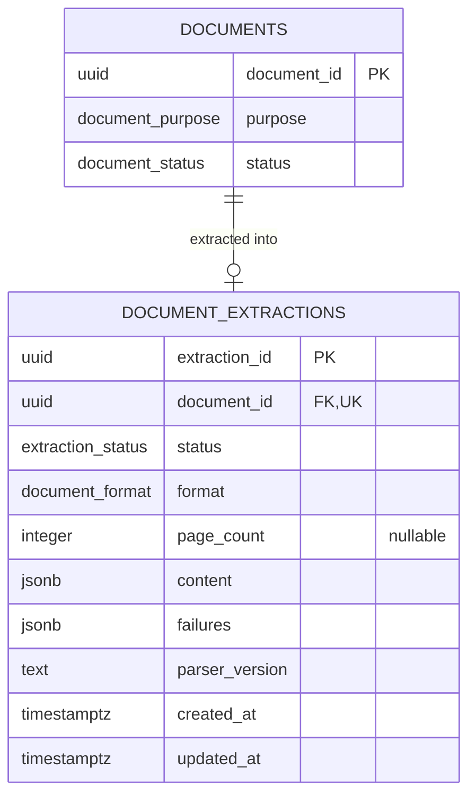
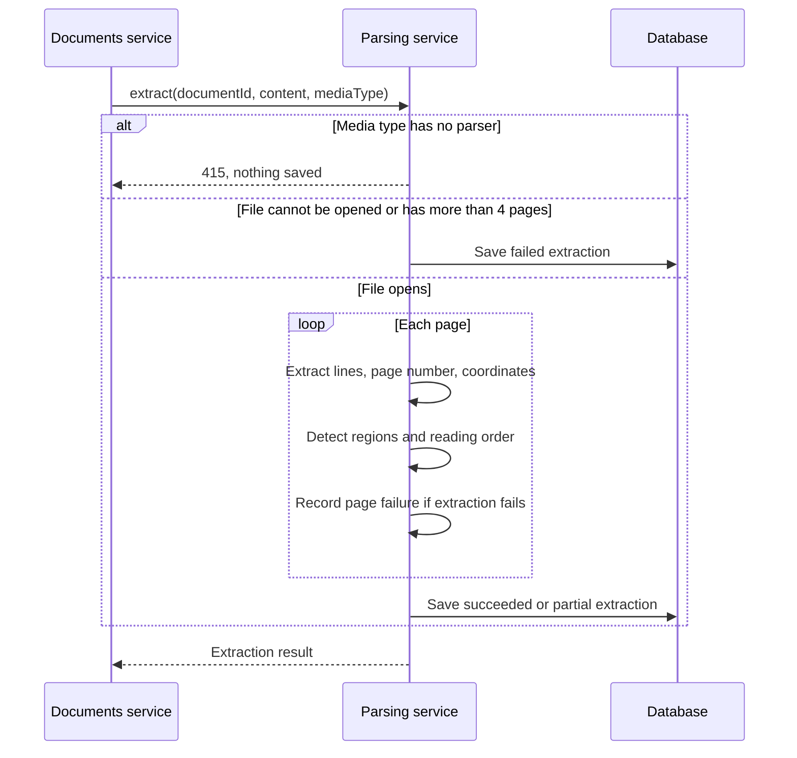

# Document parsing module plan (Part 1)

## Goal

Turn an uploaded CV (PDF or DOCX) into structured text grouped into layout
regions, where every line knows its page and position, store the result, and
keep successful pages when part of a file fails. The parser reconstructs the
CV's layout from geometry; AI interprets the meaning of each region in Part 2.

## Scope

- Extract text from PDF and DOCX source documents.
- Keep page numbers and on-page coordinates for PDF.
- Group PDF lines into layout regions (columns, full-width areas, sections) and
  read them in the correct order.
- Store one extraction result per document.
- Keep successful pages and record failed ones.
- Produce a compact, token-efficient text for AI from the stored result.
- Leave AI extraction, claims, source occurrences, OCR for scanned CVs,
  Arabic text, LinkedIn exports, certificate data from evidence documents,
  and public endpoints to Part 2 or later modules.

## Design decisions

- Add a `parsing` module that receives file bytes and a media type. It does
  not know where the file came from, so it works before the upload module is
  finished and later reads files through `documentsService` without changes.
- Parse `source` documents only; `evidence` documents are not parsed in Part 1.
- Use the Strategy pattern: one `DocumentParser` contract with a PDF parser
  and a DOCX parser, chosen by media type. A new format adds one parser without
  changing the rest.
- Use `pdfjs-dist` for PDF. It returns text with page numbers and coordinates.
- Group PDF text into lines. A wide horizontal gap splits a line, so
  side-by-side columns are not merged.
- Read what the text extraction of `pdfjs-dist` leaves out from the page's
  drawing instructions, which are already loaded for font names:
  - **Bold and italic** come from font names, such as `Calibri-Bold` or
    `Montserrat-MediumItalic`. Short forms, such as `CenturyGothic-Bd` or
    `MyriadPro-It`, are read only in the style part after the last `-` or `,`,
    so they never match inside a family name. Text drawn bold or slanted by
    other means reads as regular.
  - **Spaced-out letters**, such as a heading drawn as `A B O U T M E`, get
    their real word breaks back from the drawn text: `ABOUT ME`.
  - **List bullets drawn as shapes**, which many design tools and browsers use
    instead of a `•` character, are found as small shapes just before a line.
  - **Link targets** hidden behind text, such as "LinkedIn", come from the
    page's link areas.
- Text drawn twice at almost the same place, for a shadow or outline effect,
  is kept once.
- A line is a heading only when its font is larger than body text. Bold is
  stored but never starts a section, because bold body-size lines are often
  job titles or company names.
- Group lines into layout regions with recursive region detection, described
  below. Regions are read in order, so the lines of one column are no longer
  interleaved with the lines of another.
- Region detection lives in its own file, `layout.ts`. It works on text pieces
  with bounding boxes, builds lines and regions from them, and knows nothing
  about PDF. The PDF parser only reads the file and hands over the pieces. OCR
  output for scanned CVs can later use the same step without changes.
- The stored result keeps the lines exactly as they appear on the page. Any
  interpretation, such as joining wrapped lines, happens only when building the
  AI input, so a wrong guess never ends up stored.
- Text pieces are used while building lines and are not stored; each stored
  line keeps its text, page, and position.
- The reading direction is a parameter, left to right by default, so
  right-to-left layouts can be supported later without rewriting the
  algorithm. This does not make Arabic supported: extracting Arabic text
  itself is still deferred.
- Store coordinates from the top-left corner, with each page's width and
  height, so a client can highlight text on the page.
- Use `mammoth` for DOCX. Word files have no fixed pages or coordinates, so
  DOCX results contain ordered blocks with `pageCount = null`. A block is
  either a paragraph or a table. Tables keep their rows and cells, because a
  row often holds related facts, such as a job title, a company, and dates.
- DOCX is read through mammoth's HTML output, which keeps headings and table
  rows. Column headings are kept only when the author marked the row as a
  table header in Word; the parser never guesses them.
- Treat a PDF page without a text layer (scanned image) as a page failure
  `NO_TEXT_LAYER`, and a page that cannot be read as `PAGE_UNREADABLE`; the
  other pages are kept.
- Fail the whole file when it cannot be opened (`UNREADABLE` or
  `PASSWORD_PROTECTED`), when it has no text (`NO_TEXT_LAYER`), or when a PDF
  has more than 4 pages (`TOO_MANY_PAGES`). Oversized PDFs are rejected before
  any page is read, to protect the server.
- Arabic text is not supported yet. PDFs store Arabic in drawing order with
  special letter forms, so the extracted text comes out reversed. A file whose
  letters are 5% Arabic or more fails with `UNSUPPORTED_LANGUAGE`; below that,
  Arabic characters are removed and the rest is kept. The rule applies to PDF
  and DOCX and lives in one place, `language.ts`.
- Reject media types without a parser with `415 UNSUPPORTED_DOCUMENT_TYPE`;
  nothing is saved.
- Store the extracted content as JSONB. It is read as a whole and never
  searched with SQL; search happens later on structured claims.
- Link `document_extractions.document_id` to `documents.document_id`.
  Deleting a document deletes its extraction.
- Record the parser library and version with every result.

## Layout detection

The parser divides each PDF page into rectangular regions using only text
positions, alignment, and whitespace. It does not try to understand the CV.

**Status:** region detection, section and entry ownership, and deterministic
reading order are implemented. Tests cover unique line ownership and emitted
reading order in addition to extraction and storage.

**Guiding principle:** the goal is a correct split that keeps related
information together, not the largest number of regions. When in doubt, text
stays in one region. This makes the parser safer than aggressive splitting.

### Algorithm

1. **Extract lines** with their text and bounding boxes (already done).
2. **Find candidate boundaries.** Look for column gutters (vertical
   whitespace) and full-width bands (horizontal whitespace, such as below a
   header).
3. **Score each candidate** by combining several signals, described below,
   and split only along a boundary with high confidence.
4. **Find section boundaries** inside each region using headings and
   significant vertical gaps.
5. **Collect contained text.** Every line inside a region's rectangle belongs
   to that region, whatever its alignment.
6. **Repeat recursively** on each new region while confident boundaries exist.
7. **Restore section ownership.** When recursive splitting leaves a confirmed
   section heading alone above child regions in the same horizontal lane,
   combine them and recompute the section's union box. A document title does
   not own sections, and a new section boundary or earlier lane ends ownership.
8. **Order the result:** regions top to bottom; side-by-side regions in the
   reading direction, each read completely before the next.

When two confirmed, row-aligned section headings start opposite sides of a
persistent gutter, that gutter becomes a decisive column boundary even if
other geometric signals are weak or much of their content shares rows. This
is the narrow exception to the shared-row table safeguard.
Each lane is recursively split at its own later section headings and emitted
completely in reading direction, so a heading always precedes the content it
owns. A later standalone section heading closes all parallel lanes above it;
another aligned row of section headings starts or continues parallel lanes.
Ordinary tables and title/date pairs do not receive this exception.

An isolated section heading aligned with the active content's left edge also
starts a new page-wide layout band when a sufficiently large horizontal
whitespace band ends immediately above it. This closes every earlier
lane-local section, even when the page has no drawn horizontal rule. A rule can
support the same decision, but it is not required; aligned headings on the same
row continue to establish independent lanes instead.

A title or compact metadata value may sit on either side of the body it
describes. The parser keeps these **cross-lane ownership links** intact instead
of splitting them at the vertical gutter. A title links across only when it has
no nearby body in its own lane, so independent parallel sections remain
separate. Dates and contact-like metadata link to same-row content. This works
in either direction, and a semantic title is emitted before its linked body
even when the title is geometrically to the right.

### Entry boundaries

Section headings and lower-level entry headings have different authority. A
confirmed section heading starts a section. A lower heading may split entries
inside that section only when the pattern repeats in the same lane, nearby body
text follows, and the short bold anchor is either larger than that body or is
aligned with a date. The date is optional when the size contrast is present.
Because some PDFs lose font-weight metadata, confirmed education and experience
sections also allow a regular-font anchor when it is title-sized, separated
from preceding content, has strong entry evidence, and has an associated date.
The section category comes only from an exact normalized heading label.

The first entry stays with its section heading. Each later entry anchor starts
a region containing its aligned date or metadata and its following body up to
the next entry. A lone bold label never creates an entry boundary, and entry
pairing never crosses a confirmed section boundary.

Repeated entry anchors may use nearby body text in an adjacent lane as entry
evidence when the same anchor-to-body direction and body alignment repeat.
This permits a compact entry-title rail beside descriptions without promoting
an isolated bold label or an unrelated parallel column.

### Boundary signals

| Signal | Interpretation |
| --- | --- |
| Persistent vertical whitespace | Possible column boundary |
| Large horizontal whitespace band | Possible section boundary |
| Similar starting X across many lines | Possibly a column edge |
| Width of the resulting regions | Very narrow strips are unlikely columns |
| Line spacing on each side | A weak hint only; it can also come from font size |
| Significant vertical gap | Possibly a new block |
| Larger font than body text | Possible section heading |
| Text inside a rectangle | Belongs to that region, regardless of alignment |

### Combining signals and confidence

Whitespace alone is not enough. A column of short skills next to a column of
long sentences leaves empty space that is not a column boundary. Each
candidate boundary therefore gets a confidence score from all signals
together:

| Situation | Confidence | Decision |
| --- | --- | --- |
| Whitespace runs through the whole region and lines align on both sides | High | Split |
| Whitespace separates two groups, supported by another signal | Medium | Split only with a second signal |
| Whitespace alone, or a small alignment difference | Low | Keep the region intact |

The score adds up the signals, each measured from 0 to 1 and multiplied by its
weight:

| Signal | Weight | How it is measured |
| --- | --- | --- |
| Gutter continuity | 0.40 | How much of the region's height the empty gap runs through |
| Alignment | 0.30 | How many lines on each side start at the same X |
| Region width | 0.15 | Gradual: 0 when the narrower side is under 10% of the region, 1 above 25%, and in between it rises step by step |
| Heading support | 0.10 | 1 when a heading starts each side, else 0 |
| Line spacing difference | 0.05 | Spacing divided by line height on each side, so a bigger font does not count as a difference |

- A score of 0.7 or more splits the region.
- A score from 0.5 to 0.7 splits only when two signals are at least 0.7.
- A score below 0.5 keeps the region intact.

**This formula is a starting point, not a final decision.** The weights and
thresholds live in one place and are adjusted after testing on real CVs. The
confidence of each split is stored with its regions to help that tuning.

### Right-aligned values

A region's width comes from its containing region, not from its first line.
Values aligned on the right of the same rows, such as dates next to job titles,
stay in the same region. A narrow strip of short values whose rows line up with
the rows beside it is not treated as a separate column.

### Section-local columns

Page-wide whitespace is only provisional evidence because unrelated short
lines can create several overlapping false gutters. After section ownership is
known, the parser can instead accept columns inside that section. It excludes
the section heading, split heading continuations, and existing entry groups,
then requires repeated left-edge anchors on both sides, a clean non-crossing
gap, vertically overlapping content, and reasonably balanced lanes. A lane
containing only standalone dates is rejected so title/date rows stay together.

Accepted local columns are read one complete lane at a time in reading
direction. This preserves card-like relationships such as a certificate title
followed by its issuer, rather than interleaving the titles and issuers of two
side-by-side cards. When the local evidence is weak, the section remains
unsplit and uses row-aware ordering.

### Tables

In a PDF, a table is usually just text placed at coordinates, not a real
table. Rows are not assumed to have equal heights, and a cell can span several
lines. Gaps between table cells look like column gutters. Two checks keep a
table in one region:

- Table rows sit at the same heights on both sides of the gap, which marks
  shared rows rather than independent columns.
- A real column gutter runs through the whole region, while table gaps stop
  where the table ends.

### Areas above columns

A band of whitespace across the whole region can separate a full-width area,
such as a header, from the columns below it. The area is read first only when
it really is full width:

- It crosses the gap between the columns, such as a centred name or a contact
  line, or
- it sits on one side of the gap only, such as a name above the main column
  beside a photo.

Text on both sides of the gap that does not cross it continues the columns,
even when its lines share rows: a row of section headings, such as `CONTACT`
above the sidebar and `ABOUT ME` above the main column, or two short sections
side by side. Each part is read with the column below it.

### Multi-line text

A job description that wraps over several lines must stay together.

- A vertical gap counts as a boundary only when it is clearly larger than the
  normal line spacing, about twice the usual gap, so wrapped lines are never
  split into separate regions.
- Wrapped lines stay separate in the stored result. They are joined only in
  the AI input, and only when every signal agrees. A missed join keeps two
  lines apart; a wrong join would mix two facts, so joins are kept strict.
- Two lines are always required to:
  - be separated by normal line spacing;
  - have the same size, bold, and italic style;
  - not be headings;
  - not end the first line with `.` or `:`;
  - not start the second line with a bullet, a date, an email address, a
    link, or a phone number.
- On top of that, one of these must hold:
  - **Wrapped text:** the lines line up, or the second is indented under a
    bullet character; the next line's first word would not have fitted at the
    end of the first line, measured by the width of its own column; and the
    sentence visibly continues: the next line starts in lowercase or with an
    opening bracket, or the first line ends with a comma or a joining word,
    such as "and" or "with". Short items in a narrow sidebar, such as a phone
    number above a city, never pass this check.
  - **Rest of a list item:** the first line starts a list item, the second has
    no bullet and lines up with the item's text, and another bullet sits
    nearby in the same column. A lone dot, such as a timeline marker beside a
    job title, is not a list, so the line under it is not joined.
- A heading too long for one line, such as a name in large letters, is joined
  with the next line when that line is a heading of the same size, right
  below, and starts or is centred at the same place.
- In a grid, such as a skills list in three columns, a wrapped cell continues
  the cell above it in the same column, not the line before it in reading
  order.

### When recursion stops

- No reliable whitespace, alignment, or heading boundary exists.
- The region contains only one text block.
- A further split risks separating closely related content.

- The best boundary has low confidence.

When a boundary is uncertain, the region is left intact. Strongly supported
entry boundaries may split confirmed education and experience sections;
ambiguous grouping remains available to AI in Part 2.

### Geometry, not meaning

The parser finds where sections begin and which lines are headings. It performs
only narrow semantic routing from exact normalized education and experience
labels so entry evidence can be interpreted safely. Broader section meaning
and résumé interpretation remain AI responsibilities in Part 2.

## Phases

1. **Text extraction:** PDF and DOCX with page numbers and coordinates (done).
2. **Region detection:** columns and full-width areas, with scored
   boundaries (done).
3. **Section boundaries:** headings and vertical gaps inside regions (done).
4. **AI input:** compact grouped text with line references, joining wrapped
   lines (done).
5. **Real-world testing:** done on the CVs listed under
   [Testing approach](#testing-approach); CVs from the team, especially
   two-column CVs made outside Canva, are still to come.

### Inspecting every parsing level

Run `npm run parsing:inspect -- path/to/resume.pdf` to generate an HTML report
beside the document. For PDFs, the **Parsing levels** section shows the same
page after each deterministic stage:

Run `npm run parsing:inspect:all` to regenerate the reports beside every PDF
and DOCX in `testResumes`. Pass a directory after `--` to inspect a different
fixture directory.

1. extracted PDF text pieces;
2. pieces reconstructed into lines;
3. page-local layout metrics;
4. scored text and non-text boundary evidence;
5. provisional full-width and lane hypotheses;
6. hierarchical section scopes;
7. contextual entry groups inside confirmed sections;
8. section-local column validation;
9. unique final ownership and row-aware reading order;
10. compact AI input with stable line references.

Each stage includes positioned boxes and an exact text/coordinate list.
Section boundaries, entry boundaries, and region outlines use different
colors. The stored parsed content and compact AI input follow these diagnostic
views. Layout traces exist only in the inspection command and are not added to
the extraction result.

## Testing approach

Fixtures and expected results are written before the algorithm, so "correct"
is defined first. A correct split is not enough; every test checks that no
information is lost or misplaced:

| Check | Meaning |
| --- | --- |
| No line lost | The number of lines before and after region detection is equal |
| No line duplicated | Every line belongs to exactly one region |
| Correct region | Each line is in its expected region, for example a date stays with its job |

Layouts to test:

1. One column
2. Two columns
3. Three columns
4. Sidebar
5. Tables, including cells that span several lines
6. Right-aligned dates
7. Short skills beside long paragraphs
8. Nested regions: a full-width heading, two columns below it, a section with
   two paragraphs inside the right column, and a skills list in the left
   column

How each part is tested:

- **Layout tests** describe each layout as pieces with coordinates written
  directly in the test, for example a line at `x = 50, y = 100`. No PDF is
  needed, so every layout is precise, fast, and easy to read, and the expected
  regions are exact.
- **PDF tests** use small generated PDFs to confirm that reading a file and
  detecting regions work together: two columns, a sidebar, a header above
  columns, a row of headings above a sidebar, hidden links, spaced-out
  headings, bullets drawn as shapes, and font names with bold and italic
  styles.
- **Real CVs** are checked outside the repository and never committed. Each
  change is compared before and after on all of them, and every changed
  output is reviewed by eye.

Real CVs used so far:

| Set | What it covers |
| --- | --- |
| A team member's CV, PDF and DOCX | One column, hidden links, Arabic rejection |
| Three Canva templates | Sidebars, rows of headings, spaced-out headings, drawn bullets, cards side by side |
| 30 CVs from a public dataset, 3 from each of 10 fields | Real wording, tables, grids of skills, rendered from HTML to PDF |

The dataset CVs come with their original HTML, which marks section titles and
paragraphs. It serves as an answer key: every section title must be found as
a heading, and every joined line must come from one HTML paragraph. Results
on the 30 CVs: all 172 section titles found, all text kept, and every join
correct after review. About 75 wrapped lines in total stay unjoined because
nothing shows that the sentence continues.

## AI input

The stored result keeps every detail the system needs: text, page numbers, and
positions. AI receives a compact text built from it on demand, which is not
stored:

```text
[P1 R0]
## L1-2 LORNA ALVARADO
## L3 Sales Representative
[P1 R1]
## L4 CONTACT
L5 123-456-7890
L6 Links: LinkedIn · GitHub (links: https://www.linkedin.com/in/sample)
[P1 R5]
## L28 EXPERIENCE
L29 *Product Designer*
L30-31 _Arowwai Industries_ | 2016 - 2020
L32-34 • Led the redesign of the booking flow with engineering and design, cutting drop-off by a third.
L35 • Ran user interviews and usability tests.
L39-41,44 • Client Acquisition | • Negotiation Skills | • Relationship Management
```

- `[P1 R5]` marks page 1, region 5. Regions are numbered from 0, as stored.
- `##` marks a heading, `*text*` bold, `_text_` italic, and `•` the start of
  a list item.
- `L5` is the line's reading order: the stored line with `order = 5`. No
  separate map is needed. AI returns line references with each extracted value,
  and the system finds the line's original text, page, coordinates, and region
  in the stored result, so AI never writes coordinates.
- When lines are joined, the reference covers all of them: `L32-34` for lines
  in a row, or `L39-41,44` when a wrapped cell of a grid continues further
  down.
- Cells on the same row are kept on one line, separated by `|`: a title and
  its right-aligned date, table cells, a grid of skills, or two cards side by
  side. The parser does not guess whether a grid is a table or separate
  columns; AI reads the grid as it is drawn.
- Link targets hidden behind text are listed after it; links already written
  in the text are not repeated.
- Coordinates and text pieces are left out. On a real CV, the AI text is about
  a third of the stored JSON.
- DOCX blocks use references starting with `B`: `B3` for block 3, and `B4.1`
  for the first row of the table in block 4. DOCX has no pages, so there are
  no page markers.
- Each DOCX table row becomes one line with its cells separated by `|`, so the
  facts in a row stay together. When the table has column headings, they are
  listed first, so AI does not have to guess what each cell means:

```text
Columns: Position | Company | Period
B4.1 Developer | ABC Company | 2023 – 2025
B4.2 Intern | XYZ Ltd | 2022 – 2023
```

  A table without headings has no `Columns` line.

## Relation to the documents table

The `documents` module merges the ERD's `SourceDocument` and
`EvidenceDocument` into one `documents` table with `purpose = source | evidence`.
Parsing fields from `SourceDocument` move as follows:

| ERD field | New location |
| --- | --- |
| `parsed_content` | `document_extractions.content` |
| `failed_portions` | `document_extractions.failures` |
| `processing_status` | `documents.status` |
| `error_details` | Short code in `documents.failure_code`; details in `document_extractions.failures` |
| `attempt_count` | Part 2, with retries |
| `unmapped_data` | Part 2, with AI extraction |

File fields such as name, format, size, hash, and storage reference stay in
`documents`. `EvidenceDocument` certificate fields belong to the later evidence
and verification module.

## Output contract

- `status`: `succeeded`, `partial`, or `failed`
- `format`: `pdf` or `docx`
- `pageCount`: number of pages, or `null` for DOCX
- `content.version`: the version of the content shape, now `3`, so code can
  tell results of different shapes apart when the shape changes again
- `pages`: for each page, its number, width, height, and ordered regions; each
  region has its index, bounding box, split confidence, and lines; each line
  has its text, bounding box, reading order, and whether it is a heading,
  bold, italic, or the start of a list item, and its link targets
- Reading order runs across the whole document, so each line's order is
  unique and serves as its AI reference.
- Split confidence is the score of the boundary that created the region. It is
  `null` when the region was not created by a split, such as a page that stays
  whole.
- `blocks`: for DOCX, ordered blocks; a paragraph block has its text, whether
  it is a heading, bold, or italic, and its link targets; a table block has
  its column headings when present and its rows, each row a list of cell
  texts
- `failures`: failed page numbers with an error code
- `parserVersion`: library name and version

## Data model



- `extraction_status`: `succeeded`, `partial`, `failed`
- `document_format`: `pdf`, `docx`
- Parsing a document again replaces its extraction and updates `updated_at`.
- Region detection changes the shape of `content` only; the table and its
  migration stay the same.

## Parsing flow



## Known limitations

- **Cards side by side**, such as two references, are kept as a grid: one
  line per row, with the cells separated by `|`. AI pairs each column. The
  parser does not split them, because geometry cannot tell them apart from a
  table such as `Skill | Level`, whose rows must stay together.
- **Rows that happen to line up:** text on both sides of a gap counts as one
  row when the centres of the lines are within half a line height. A dense
  column beside a sparse one can then look like a table and stay one region.
  This did not happen on the real CVs tested; comparing baselines more
  strictly is a possible next step.
- **A lone dot**, such as a timeline marker, marks the line beside it as a
  list item (`•`), although it does not join lines.
- **Unjoined wrapped lines** remain when nothing shows that the sentence
  continues, for example a line ending in "a Full" followed by "Stack". AI
  still reads both lines.
- **Word breaks of spaced-out letters** are lost when the file does not keep
  them; `A B O U T M E` then becomes `ABOUTME`.
- **Bold and italic** come from font names only. Fonts without a weight or
  slant in their names, or text made bold by drawing it twice, read as
  regular.
- **Scanned CVs** fail with `NO_TEXT_LAYER` until OCR is added. `layout.ts`
  works on positioned text pieces, so OCR output can use it unchanged.
- **Arabic** is not supported yet.

## Open questions

- More real CVs from the team are needed, especially two-column CVs made
  outside Canva and multi-page CVs.
- Is leaving job-entry splitting to AI acceptable?
- The starting weights and thresholds for the confidence score were not
  changed after testing on real CVs. They stay in `LAYOUT_SETTINGS`.

## Implementation

- [x] Review the first plan with the team.
- [x] Add PDF and DOCX test fixtures.
- [x] Define the input and output types.
- [x] Add the PDF reader with pages, lines, and coordinates.
- [x] Add the DOCX reader with ordered paragraphs.
- [x] Add partial results and error codes.
- [x] Add `document_extractions`, its migration, and the repository.
- [x] Share `parsingService` with other modules.
- [x] Update the data model documentation.
- [x] Review the layout detection plan with the team.
- [x] Move line building from `pdf-parser.ts` to `layout.ts` without changing
  its behavior; existing tests must still pass.
- [x] Add fixtures and expected regions for the eight test layouts.
- [x] Add checks that no line is lost, duplicated, or placed in the wrong region.
- [x] Add regions, reading order, split confidence, and `content.version` to
  the output types, and stop storing text pieces.
- [x] Add recursive region detection for columns and full-width areas, with
  boundaries scored from combined signals.
- [x] Make the reading direction a parameter.
- [x] Add section boundaries from headings and vertical gaps.
- [x] Keep DOCX headings, table rows, and cells by reading mammoth's HTML.
- [x] Add the compact AI input with line references, joining wrapped lines.
- [x] Read hidden link targets from PDF link areas.
- [x] Keep rows of section headings and side-by-side sections with the columns
  below them.
- [x] Read bold and italic from font names, including short forms.
- [x] Restore word breaks of spaced-out letters and keep one copy of text drawn
  twice.
- [x] Find list bullets drawn as shapes and join the rest of a list item.
- [x] Keep cells of one row on one AI input line and continue wrapped cells in
  their own column.
- [ ] Before committing, regenerate the `document_extractions` migration on top
  of the latest `Main`: another branch also adds a migration numbered `0004`.
- [ ] Update the open pull request with this work.

## Verification

- [x] Test single-page and multi-page PDFs.
- [x] Test that each line has the correct page number and a box inside the page.
- [x] Test scanned, corrupt, password-protected, and oversized PDFs.
- [x] Test DOCX paragraphs, tables, and empty documents.
- [x] Test that mostly Arabic PDFs and DOCX files fail and small Arabic
  fragments are removed.
- [x] Test that partial results keep successful pages.
- [x] Test saving, reading, and deleting an extraction with the documents API.
- [x] Run focused tests, `npm test`, and `npm run build`.
- [x] Test that two- and three-column CVs are read one column at a time.
- [x] Test that a full-width header stays above the columns.
- [x] Test that a row of headings and side-by-side sections stay with the
  columns below them.
- [x] Test that right-aligned dates stay with their entries.
- [x] Test that a column of short skills beside long sentences is split
  correctly, and that a low-confidence boundary keeps the region intact.
- [x] Test that PDF tables stay in one region, including cells that span
  several lines.
- [x] Test that DOCX tables keep their column headings, rows, and cells.
- [x] Test that nested splits keep earlier splits intact.
- [x] Test that multi-line job descriptions stay together.
- [x] Test that no line is lost or duplicated in every layout.
- [x] Test the compact AI input and its line references.
- [x] Test with real CVs of different layouts.
- [ ] Test with more real CVs from the team.
- [ ] Have another team member test and review the code.
