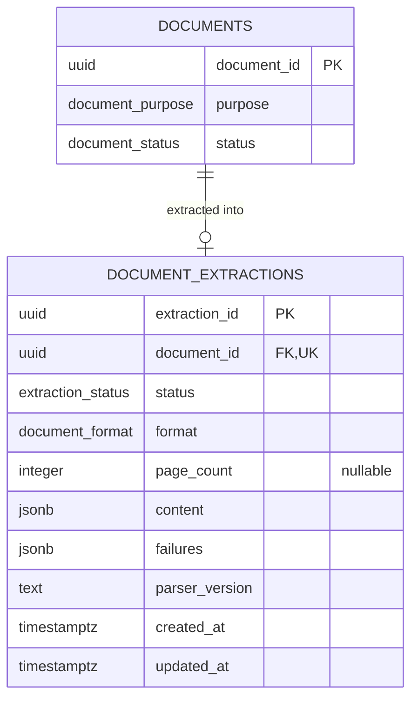
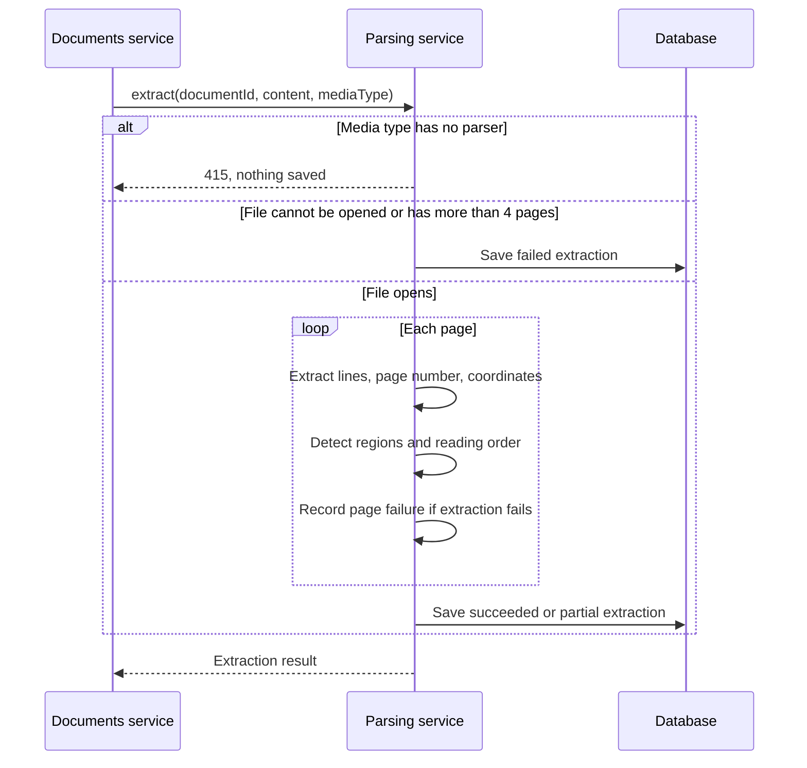

# Document parsing module plan (Part 1)

## Goal

Turn an uploaded CV (PDF or DOCX) into structured text grouped into layout
regions, where every line knows its page and position, store the result, and
keep successful pages when part of a file fails. The parser reconstructs the
CV's layout from geometry; AI interprets the meaning of each region in Part 2.

## Scope

- Extract text from PDF and DOCX source documents.
- Keep page numbers and on-page coordinates for PDF.
- Group PDF lines into layout regions (columns, full-width areas, sections) and
  read them in the correct order.
- Store one extraction result per document.
- Keep successful pages and record failed ones.
- Produce a compact, token-efficient text for AI from the stored result.
- Leave AI extraction, claims, source occurrences, OCR for scanned CVs,
  Arabic text, LinkedIn exports, certificate data from evidence documents,
  and public endpoints to Part 2 or later modules.

## Design decisions

- Add a `parsing` module that receives file bytes and a media type. It does
  not know where the file came from, so it works before the upload module is
  finished and later reads files through `documentsService` without changes.
- Parse `source` documents only; `evidence` documents are not parsed in Part 1.
- Use the Strategy pattern: one `DocumentParser` contract with a PDF parser
  and a DOCX parser, chosen by media type. A new format adds one parser without
  changing the rest.
- Use `pdfjs-dist` for PDF. It returns text with page numbers and coordinates.
- Group PDF text into lines. A wide horizontal gap splits a line, so
  side-by-side columns are not merged.
- Group lines into layout regions with recursive region detection, described
  below. Regions are read in order, so the lines of one column are no longer
  interleaved with the lines of another.
- Region detection lives in its own file, `layout.ts`. It works on text pieces
  with bounding boxes, builds lines and regions from them, and knows nothing
  about PDF. The PDF parser only reads the file and hands over the pieces. OCR
  output for scanned CVs can later use the same step without changes.
- The stored result keeps the lines exactly as they appear on the page. Any
  interpretation, such as joining wrapped lines, happens only when building the
  AI input, so a wrong guess never ends up stored.
- Text pieces are used while building lines and are not stored; each stored
  line keeps its text, page, and position.
- The reading direction is a parameter, left to right by default, so
  right-to-left layouts can be supported later without rewriting the
  algorithm. This does not make Arabic supported: extracting Arabic text
  itself is still deferred.
- Store coordinates from the top-left corner, with each page's width and
  height, so a client can highlight text on the page.
- Use `mammoth` for DOCX. Word files have no fixed pages or coordinates, so
  DOCX results contain ordered blocks with `pageCount = null`. A block is
  either a paragraph or a table. Tables keep their rows and cells, because a
  row often holds related facts, such as a job title, a company, and dates.
- DOCX is read through mammoth's HTML output, which keeps headings and table
  rows. Column headings are kept only when the author marked the row as a
  table header in Word; the parser never guesses them.
- Treat a PDF page without a text layer (scanned image) as a page failure
  `NO_TEXT_LAYER`, and a page that cannot be read as `PAGE_UNREADABLE`; the
  other pages are kept.
- Fail the whole file when it cannot be opened (`UNREADABLE` or
  `PASSWORD_PROTECTED`), when it has no text (`NO_TEXT_LAYER`), or when a PDF
  has more than 4 pages (`TOO_MANY_PAGES`). Oversized PDFs are rejected before
  any page is read, to protect the server.
- Arabic text is not supported yet. PDFs store Arabic in drawing order with
  special letter forms, so the extracted text comes out reversed. A file whose
  letters are 5% Arabic or more fails with `UNSUPPORTED_LANGUAGE`; below that,
  Arabic characters are removed and the rest is kept. The rule applies to PDF
  and DOCX and lives in one place, `language.ts`.
- Reject media types without a parser with `415 UNSUPPORTED_DOCUMENT_TYPE`;
  nothing is saved.
- Store the extracted content as JSONB. It is read as a whole and never
  searched with SQL; search happens later on structured claims.
- Link `document_extractions.document_id` to `documents.document_id`.
  Deleting a document deletes its extraction.
- Record the parser library and version with every result.

## Layout detection

The parser divides each PDF page into rectangular regions using only text
positions, alignment, and whitespace. It does not try to understand the CV.

**Status:** region detection is planned and not built yet. The current tests
prove text extraction and storage only; they do not prove that columns,
regions, or reading order work.

**Guiding principle:** the goal is a correct split that keeps related
information together, not the largest number of regions. When in doubt, text
stays in one region. This makes the parser safer than aggressive splitting.

### Algorithm

1. **Extract lines** with their text and bounding boxes (already done).
2. **Find candidate boundaries.** Look for column gutters (vertical
   whitespace) and full-width bands (horizontal whitespace, such as below a
   header).
3. **Score each candidate** by combining several signals, described below,
   and split only along a boundary with high confidence.
4. **Find section boundaries** inside each region using headings and
   significant vertical gaps.
5. **Collect contained text.** Every line inside a region's rectangle belongs
   to that region, whatever its alignment.
6. **Repeat recursively** on each new region while confident boundaries exist.
7. **Order the result:** regions top to bottom; side-by-side regions in the
   reading direction, each read completely before the next.

### Boundary signals

| Signal | Interpretation |
| --- | --- |
| Persistent vertical whitespace | Possible column boundary |
| Large horizontal whitespace band | Possible section boundary |
| Similar starting X across many lines | Possibly a column edge |
| Width of the resulting regions | Very narrow strips are unlikely columns |
| Line spacing on each side | A weak hint only; it can also come from font size |
| Significant vertical gap | Possibly a new block |
| Larger font than body text | Possible section heading |
| Text inside a rectangle | Belongs to that region, regardless of alignment |

### Combining signals and confidence

Whitespace alone is not enough. A column of short skills next to a column of
long sentences leaves empty space that is not a column boundary. Each
candidate boundary therefore gets a confidence score from all signals
together:

| Situation | Confidence | Decision |
| --- | --- | --- |
| Whitespace runs through the whole region and lines align on both sides | High | Split |
| Whitespace separates two groups, supported by another signal | Medium | Split only with a second signal |
| Whitespace alone, or a small alignment difference | Low | Keep the region intact |

The score adds up the signals, each measured from 0 to 1 and multiplied by its
weight:

| Signal | Weight | How it is measured |
| --- | --- | --- |
| Gutter continuity | 0.40 | How much of the region's height the empty gap runs through |
| Alignment | 0.30 | How many lines on each side start at the same X |
| Region width | 0.15 | Gradual: 0 when the narrower side is under 10% of the region, 1 above 25%, and in between it rises step by step |
| Heading support | 0.10 | 1 when a heading starts each side, else 0 |
| Line spacing difference | 0.05 | Spacing divided by line height on each side, so a bigger font does not count as a difference |

- A score of 0.7 or more splits the region.
- A score from 0.5 to 0.7 splits only when two signals are at least 0.7.
- A score below 0.5 keeps the region intact.

**This formula is a starting point, not a final decision.** The weights and
thresholds live in one place and are adjusted after testing on real CVs. The
confidence of each split is stored with its regions to help that tuning.

### Right-aligned values

A region's width comes from its containing region, not from its first line.
Values aligned on the right of the same rows, such as dates next to job titles,
stay in the same region. A narrow strip of short values whose rows line up with
the rows beside it is not treated as a separate column.

### Tables

In a PDF, a table is usually just text placed at coordinates, not a real
table. Rows are not assumed to have equal heights, and a cell can span several
lines. Gaps between table cells look like column gutters. Two checks keep a
table in one region:

- Table rows sit at the same heights on both sides of the gap, which marks
  shared rows rather than independent columns.
- A real column gutter runs through the whole region, while table gaps stop
  where the table ends.

### Multi-line text

A job description that wraps over several lines must stay together.

- A vertical gap counts as a boundary only when it is clearly larger than the
  normal line spacing, about twice the usual gap, so wrapped lines are never
  split into separate regions.
- Wrapped lines stay separate in the stored result. They are joined only in
  the AI input, and only when several signals agree, never because of one
  signal alone:
  - the gap between them is normal line spacing;
  - they line up, or the second is indented under a bullet;
  - the first line does not end with `.` or `:`;
  - the second line does not start with a bullet, a date, or a heading.
- A lowercase first letter can support a merge, but it is never enough on its
  own.

### When recursion stops

- No reliable whitespace, alignment, or heading boundary exists.
- The region contains only one text block.
- A further split risks separating closely related content.

- The best boundary has low confidence.

When a boundary is uncertain, the region is left intact. Splitting a section
into individual entries, such as separate jobs, is left to AI in Part 2.

### Geometry, not meaning

The parser finds where sections begin and which lines are headings. It does
not decide what a section is. Recognizing that a region holds experience,
education, or skills is meaning, and AI handles it in Part 2.

## Phases

1. **Text extraction:** PDF and DOCX with page numbers and coordinates (done).
2. **Region detection:** columns and full-width areas, with scored
   boundaries.
3. **Section boundaries:** headings and vertical gaps inside regions.
4. **AI input:** compact grouped text with line references, joining wrapped
   lines.
5. **Real-world testing:** 5 to 10 real CVs with different layouts.

## Testing approach

Fixtures and expected results are written before the algorithm, so "correct"
is defined first. A correct split is not enough; every test checks that no
information is lost or misplaced:

| Check | Meaning |
| --- | --- |
| No line lost | The number of lines before and after region detection is equal |
| No line duplicated | Every line belongs to exactly one region |
| Correct region | Each line is in its expected region, for example a date stays with its job |

Layouts to test:

1. One column
2. Two columns
3. Three columns
4. Sidebar
5. Tables, including cells that span several lines
6. Right-aligned dates
7. Short skills beside long paragraphs
8. Nested regions: a full-width heading, two columns below it, a section with
   two paragraphs inside the right column, and a skills list in the left
   column

How each part is tested:

- **Layout tests** describe each layout as pieces with coordinates written
  directly in the test, for example a line at `x = 50, y = 100`. No PDF is
  needed, so every layout is precise, fast, and easy to read, and the expected
  regions are exact.
- **PDF tests** use two or three generated PDFs to confirm that reading a file
  and detecting regions work together.
- **Real CVs** from the team are checked manually and are not committed.

## AI input

The stored result keeps every detail the system needs: text, page numbers, and
positions. AI receives a compact text built from it on demand, which is not
stored:

```text
[P1 R1]
L1 Sample Candidate
L2 Backend Developer
[P1 R2]
## L3 Skills
L4 Python, Node.js, Docker
[P1 R3]
## L5 Experience
L6 Backend Developer · Example Corp · 2021 – 2023
L7 • Built REST APIs with Node.js and PostgreSQL.
```

- `[P1 R2]` marks page 1, region 2; `##` marks a heading.
- `L5` is the line's reading order: the stored line with `order = 5`. No
  separate map is needed. AI returns line references with each extracted value,
  and the system finds the line's original text, page, coordinates, and region
  in the stored result, so AI never writes coordinates.
- When wrapped lines are joined, the reference covers all of them, for example
  `L5-6`.
- Coordinates and text pieces are left out, which cuts the tokens sent to AI
  to roughly a quarter of the stored JSON.
- DOCX paragraphs use the same format without page markers.
- Each DOCX table row becomes one line with its cells separated by `|`, so the
  facts in a row stay together. When the table has column headings, they are
  listed first, so AI does not have to guess what each cell means:

```text
Table 1
Columns: Position | Company | Period
L8 Developer | ABC Company | 2023 – 2025
L9 Intern | XYZ Ltd | 2022 – 2023
```

  A table without headings has no `Columns` line.

## Relation to the documents table

The `documents` module merges the ERD's `SourceDocument` and
`EvidenceDocument` into one `documents` table with `purpose = source | evidence`.
Parsing fields from `SourceDocument` move as follows:

| ERD field | New location |
| --- | --- |
| `parsed_content` | `document_extractions.content` |
| `failed_portions` | `document_extractions.failures` |
| `processing_status` | `documents.status` |
| `error_details` | Short code in `documents.failure_code`; details in `document_extractions.failures` |
| `attempt_count` | Part 2, with retries |
| `unmapped_data` | Part 2, with AI extraction |

File fields such as name, format, size, hash, and storage reference stay in
`documents`. `EvidenceDocument` certificate fields belong to the later evidence
and verification module.

## Output contract

- `status`: `succeeded`, `partial`, or `failed`
- `format`: `pdf` or `docx`
- `pageCount`: number of pages, or `null` for DOCX
- `content.version`: the version of the content shape, starting at `2`, so code
  can tell results of different shapes apart when the shape changes again
- `pages`: for each page, its number, width, height, and ordered regions; each
  region has its index, bounding box, split confidence, and lines; each line
  has its text, bounding box, reading order, and whether it is a heading
- Reading order runs across the whole document, so each line's order is
  unique and serves as its AI reference.
- Split confidence is the score of the boundary that created the region. It is
  `null` when the region was not created by a split, such as a page that stays
  whole.
- `blocks`: for DOCX, ordered blocks; a paragraph block has its text, and a
  table block has its column headings when present and its rows, each row a
  list of cell texts
- `failures`: failed page numbers with an error code
- `parserVersion`: library name and version

## Data model



- `extraction_status`: `succeeded`, `partial`, `failed`
- `document_format`: `pdf`, `docx`
- Parsing a document again replaces its extraction and updates `updated_at`.
- Region detection changes the shape of `content` only; the table and its
  migration stay the same.

## Parsing flow



## Open questions

- Which real CVs do we test with? Region detection needs 5 to 10 real CVs with
  different layouts (one column, sidebar, two or three columns, tables).
- Is leaving job-entry splitting to AI acceptable?
- Are the starting weights and thresholds for the confidence score acceptable?
  They are tuned on real CVs.

## Implementation

- [x] Review the first plan with the team.
- [x] Add PDF and DOCX test fixtures.
- [x] Define the input and output types.
- [x] Add the PDF reader with pages, lines, and coordinates.
- [x] Add the DOCX reader with ordered paragraphs.
- [x] Add partial results and error codes.
- [x] Add `document_extractions`, its migration, and the repository.
- [x] Share `parsingService` with other modules.
- [x] Update the data model documentation.
- [x] Review the layout detection plan with the team.
- [ ] Move line building from `pdf-parser.ts` to `layout.ts` without changing
  its behavior; existing tests must still pass.
- [ ] Add fixtures and expected regions for the eight test layouts.
- [ ] Add checks that no line is lost, duplicated, or placed in the wrong region.
- [ ] Add regions, reading order, split confidence, and `content.version` to
  the output types, and stop storing text pieces.
- [ ] Add recursive region detection for columns and full-width areas, with
  boundaries scored from combined signals.
- [ ] Make the reading direction a parameter.
- [ ] Add section boundaries from headings and vertical gaps.
- [ ] Keep DOCX headings, table rows, and cells by reading mammoth's HTML.
- [ ] Add the compact AI input with line references, joining wrapped lines.

## Verification

- [x] Test single-page and multi-page PDFs.
- [x] Test that each line has the correct page number and a box inside the page.
- [x] Test scanned, corrupt, password-protected, and oversized PDFs.
- [x] Test DOCX paragraphs, tables, and empty documents.
- [x] Test that mostly Arabic PDFs and DOCX files fail and small Arabic
  fragments are removed.
- [x] Test that partial results keep successful pages.
- [x] Test saving, reading, and deleting an extraction with the documents API.
- [x] Run focused tests, `npm test`, and `npm run build`.
- [ ] Test that two- and three-column CVs are read one column at a time.
- [ ] Test that a full-width header stays above the columns.
- [ ] Test that right-aligned dates stay with their entries.
- [ ] Test that a column of short skills beside long sentences is split
  correctly, and that a low-confidence boundary keeps the region intact.
- [ ] Test that PDF tables stay in one region, including cells that span
  several lines.
- [ ] Test that DOCX tables keep their column headings, rows, and cells.
- [ ] Test that nested splits keep earlier splits intact.
- [ ] Test that multi-line job descriptions stay together.
- [ ] Test that no line is lost or duplicated in every layout.
- [ ] Test the compact AI input and its line references.
- [ ] Test with real CVs of different layouts.
- [ ] Have another team member test and review the code.
