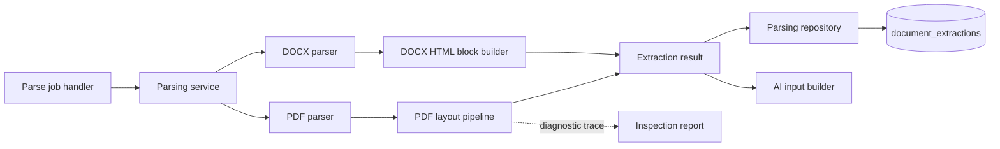
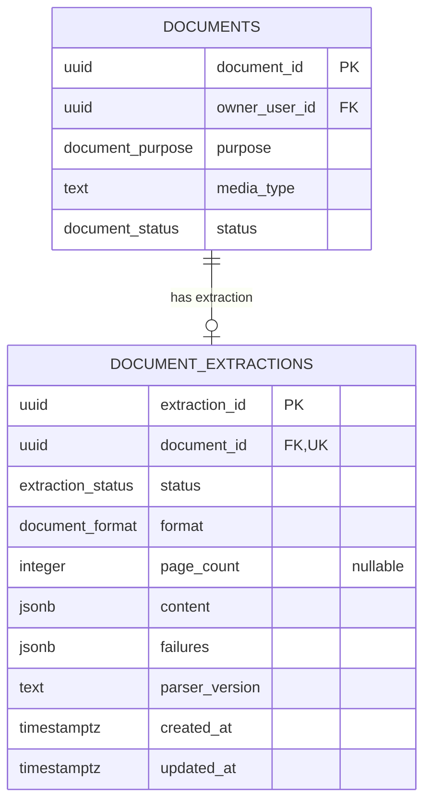

# Document parsing module

## Purpose and scope

The parsing module turns an uploaded source CV into deterministic, referenced
text for storage and later AI interpretation.

- PDF output contains positioned pages, regions, and lines.
- DOCX output contains ordered paragraphs and table blocks; Word documents do
  not provide stable page geometry.
- Successful PDF pages are retained when another page fails.
- Compact AI input is derived from stored output and keeps stable references.

The module does not extract résumé claims or decide the semantic meaning of a
section. OCR, Arabic reconstruction, evidence-document interpretation, and
public upload endpoints are outside its scope.

## Core design rules

- Preserve every extracted line exactly once.
- Keep extraction facts separate from inferred layout relationships.
- Treat typography, whitespace, gutters, alignment, and drawn rules as
  evidence rather than automatic boundaries.
- Establish likely section and entry relationships before validating
  destructive splits.
- Prefer an unsplit region to a split that separates related content.
- Keep uncertainty and scoring reasons in inspection traces, not persisted
  output.
- Keep stored text unchanged; conservative joining belongs to AI formatting.
- Use geometry and repeated visual structure for layout. AI remains responsible
  for broader résumé interpretation.

The critical dependency is:

```text
extraction evidence
-> provisional layout hypotheses
-> section and entry reasoning across those hypotheses
-> associations and entry groups
-> validated splits
-> final ownership and reading order
```

A gutter may suggest geometry, but it must not by itself terminate a section,
prevent a cross-gutter association, or decide ownership.

## Format handling

The parsing service selects a parser by exact media type.

### PDF

`pdfjs-dist` supplies text pieces, page dimensions, transforms, and font data.
The parser also reads link annotations and drawing operations used for bullets
and separators. Coordinates are stored in points from the top-left.

- PDFs with more than four pages fail before page extraction.
- A page without text fails with `NO_TEXT_LAYER`.
- An unreadable page fails with `PAGE_UNREADABLE`.
- Other readable pages are retained and the extraction becomes `partial`.
- Open, password, and language failures apply to the whole file.

### DOCX

`mammoth` HTML output preserves ordered paragraphs, headings, links, and table
rows. A table keeps its cells and an explicitly marked header row. DOCX output
has `pageCount = null` and does not use the PDF layout pipeline.

### Language policy

Arabic layout reconstruction is not supported. A file at or above the shared
Arabic-character threshold fails with `UNSUPPORTED_LANGUAGE`; smaller Arabic
fragments are removed and the remainder is retained.

Unsupported media types return `415 UNSUPPORTED_DOCUMENT_TYPE` and are not
saved.

## Component responsibilities



| Component | Responsibility | Must not do |
| --- | --- | --- |
| Parsing service | `parse`: select a parser by exact media type and return its result without saving it. `saveExtraction`: save a result, inside the caller's transaction when one is given | Interpret CV meaning or contain format-specific parsing rules |
| PDF parser | Open and validate PDFs; extract page primitives, links, styles, marks, and separators; record page failures | Decide final layout ownership |
| DOCX parser and HTML builder | Convert DOCX to ordered paragraph/table blocks and preserve explicit Word structure | Invent page coordinates or run the PDF layout pipeline |
| Language policy | Apply the shared Arabic threshold and remove permitted fragments | Perform OCR or reconstruct Arabic layout |
| PDF layout pipeline | Reconstruct lines, measure geometry, score candidates, resolve scopes and groups, and produce compatibility plus shadow layouts | Normalize résumé claims or infer broad section meaning |
| AI input builder | Format stored output into compact text with stable references and conservative joins | Modify stored text or repair incorrect ownership |
| Parsing repository | Upsert, optionally in a given transaction, and retrieve one versioned extraction per document | Recompute parsing results or query inside the JSON as domain data |
| Inspection report | Render stage evidence, scores, associations, ownership, and AI previews for diagnostics | Define persisted behavior or become a production contract |

The documents module owns file metadata, storage, lifecycle status, and the
decision to invoke parsing. The parsing module owns extraction results from the
point it receives bytes and a media type.

## PDF layout pipeline

The deterministic trace executes these stages in order.

### 1. Extract page primitives

Collect text pieces and boxes, page dimensions, font/style hints, hidden link
targets, small drawn marks, and horizontal or vertical separators. Separators
are distinct from bullet marks. A thin path or rectangle is boundary evidence,
not an automatic split.

### 2. Reconstruct visual lines

Merge compatible pieces sharing a baseline and ordinary spacing while keeping
large gaps and repeated lanes separate. This stage removes duplicate overlaid
text, restores spaced-out heading words when possible, attaches links and
nearby bullets, and retains geometry and style evidence. It does not classify
sections, entries, or columns.

### 3. Measure page statistics

Derive page-local body height, ordinary vertical gap, common edges, repeated X
lanes and row baselines, style clusters, candidate gutters, whitespace bands,
and separator coverage. Sparse pages use safe fallbacks.

### 4. Score boundary candidates

Each line receives independent evidence for document header, section, entry,
and ordinary content roles. Non-text candidates come from gutters, whitespace
bands, separators, and repeated alignment changes. Scores retain their
reasons, and local context later resolves competing roles.

### 5. Propose macro layout hypotheses

Generate non-destructive candidates for full-width headers or sections,
sidebars, lane systems, and strong horizontal divisions. Lines may participate
in multiple hypotheses. Metadata rails, right-aligned dates, tables, cards,
and skills grids must not become page divisions merely because they leave
whitespace.

### 6. Establish section scopes

Resolve section candidates using typography, normalized whole-line labels,
spacing, separators, repeated heading style, lane continuity, same-row peers,
and the next governing boundary.

A section may span provisional lanes. Parallel scopes require positive
evidence for independent headings and lane-local structure. A person name or
job title does not become a section solely because it is short, bold, or
larger than body text.

### 7. Resolve entries and associations

Entry anchors are resolved only inside confirmed sections. Evidence includes
repeated anchor style, spacing, aligned metadata, nearby body text, and
recurring entry geometry. Context may demote a preliminary section candidate
to an entry anchor.

Before splitting, create associations such as `same-entry`,
`anchor-metadata`, `anchor-body`, `metadata-body`, `wrapped-line`,
`same-row-cell`, and `section-content`. Discovery must cross provisional
gutters when geometry supports a relationship. Connected associations form
entry groups, including two-rail entries whose metadata and body occupy
different lanes.

### 8. Validate zones and constrained splits

Validate macro and section-local columns only after scopes and groups exist. A
split is rejected when it would cut a protected association or entry group,
remove section ownership, divide wrapped text, or break a shared-row grid.

Separate visual regions may retain the same section parent. A vertical split
through a section is accepted only when shared ownership remains intact or
strong evidence establishes independent parallel scopes. Ambiguous candidates
remain unsplit.

### 9. Resolve final ownership

Produce stable regions with roles such as `independent`, `section`, `entry`,
and `content`. Assign parent indexes only after region indexes stabilize.
Every reconstructed line must have exactly one final owner.

### 10. Assign reading order and AI input

Assign order after ownership: page, macro area, section, entry, and then
anchor/metadata/body when supported; geometry is the fallback. Every line gets
one unique global order number.

Compact input preserves page, region, role, parent, and line references. It
may conservatively join wrapped lines or keep unresolved same-row cells
together, but cannot repair an earlier ownership error.

## Current rollout status

All stages execute in PDF inspection traces. The revised associations, entry
groups, constrained splits, final ownership, reading order, and AI input
currently run as a shadow pipeline.

Persisted `ParsedPage` regions and production `buildAiInput` still use the
compatibility output. Activating revised regions is a separate, versioned
contract change after fixture review. The shadow pipeline asserts unique
ownership and makes the proposed replacement inspectable without silently
changing stored extraction results.

## AI adjudication of uncertain decisions

Geometry and reading order stay deterministic. A low-token AI step may settle
only the line roles the deterministic pipeline is unsure about; it runs on the
shadow pipeline, for PDFs, and only in the inspection tool
(`npm run parsing:inspect -- <pdf> [output] --adjudicate`).

1. **Collect cases** (`parsing-adjudication.ts`) from the deterministic trace:
   - `heading_role`: a provisional section heading (score at least 0.5, or
     competing entry evidence): `section_heading`, `entry_headline`, or
     `content`;
   - `entry_boundary`: a demoted or mid-confidence entry anchor
     (0.3 to 0.6): `starts_entry` or `continues_entry`;
   - `gutter_meaning`: same-row provisional headings split by a gutter:
     `shared_section`, `independent_sections`, or `metadata_rail`.

   Each case carries line references (`p1-l12`), the target lines, and up to
   three nearby lines. No line is asked about twice. High-confidence decisions
   produce no case, and a PDF with no case makes no AI request.
2. **Ask once per CV** (`parsing-adjudication.ai.ts`): every case goes in one
   request through `LlmService` (task `parsing_adjudication`, prompt
   `parsing-adjudication-v1`). The output
   `{decisions: [{case, choice, confidence, reason}]}` is validated with Ajv.
   The parser's decision is kept for a case with no answer, an option outside
   the case's list, or confidence below 0.75, and for every case when the
   request fails or returns invalid JSON.
3. **Rebuild with role overrides** (`parsing-adjudication.run.ts`): only
   choices that differ from the parser's decision become overrides, and the
   PDF is parsed again with them. A confirmed heading becomes a confirmed
   scope; independent sections become confirmed `lane-local` scopes; a
   metadata rail is no longer a heading; a continuing anchor no longer starts
   an entry. Line boxes, ownership, and reading order are recomputed by the
   deterministic stages, so the AI cannot change coordinates or order, and
   every line still has one owner.

The array of decisions has no length limit in the schema because Gemini
rejects such limits on this schema as too complex to serve; answers are
matched to cases by number and extra answers are ignored.

## Heading and role scoring

Heading detection identifies document titles, confirmed section headings,
uncertain candidates, and body lines without treating every bold line as a
heading.

### Normalization and vocabulary

Normalize with NFKC, remove trailing `.`/`:`/`|`, collapse whitespace, trim,
and lowercase. Match the complete normalized line, never a substring:
`Bachelor of Education` is not the `education` section label.

Common labels and variants live in one exported constant. They cover profile,
contact, education, experience, skills, projects, certifications, training,
languages, awards, publications, volunteering, interests, references, and
additional-information sections. New aliases require focused scoring and
scope tests.

### Evidence and classification

Positive evidence includes exact labels, larger-than-body typography, bold
compact text, capitalization, spacing, separators, and repetition matching a
trusted section style. Negative evidence includes bullets, dates, contact
values, long sentences, number-dominant metadata, and title-area prominence.
Negative lines cannot establish a repeated heading style.

Repetition is resolved in two passes. The first finds weak repetition among
intrinsically heading-shaped lines. Exact labels and strong intrinsic evidence
then establish reliable anchors. The second pass uses only styles matching
those anchors, preventing ordinary bold job titles from confirming each other.

Document titles are separate and never open sections. Confirmed headings may
establish scopes; uncertain candidates remain visible in traces and model
input but do not split content alone.

## Separator, table, and grid safeguards

A separator contributes boundary evidence when it is thin relative to body
text, spans a meaningful part of the relevant area, lies between text groups,
and is supported by nearby spacing or headings.

Never split solely because a rule exists. Underlines, decorative accents,
timelines, box borders, and repeated table rules are common false positives.
Repeated parallel rules are table/card evidence before section evidence.

Aligned rows across a gap may represent a table, skills grid, reference cards,
or title/date pairs. Shared-row structures stay unsplit unless stronger
independent-section evidence exists.

## Wrapped text and compact AI input

Stored lines remain separate. Model input joins lines only when spacing,
style, alignment, punctuation, available width, and continuation language
agree. Dates, contacts, links, bullets, and competing cells veto unsafe joins.
Wrapped grid cells continue in their own column.

```text
[P1 R5]
## L28 EXPERIENCE
L29 *Product Designer*
L30-31 _Arowwai Industries_ | 2016 - 2020
L32-34 • Led the redesign of the booking flow with engineering and design.
```

`P` identifies the page, `R` the zero-based region, and `L` the globally
ordered stored line. Joined references cover every contributing line. Hidden
links are annotated after visible text; coordinates and scores are excluded.

DOCX references use `B`, such as `B3` for a paragraph and `B4.1` for the first
row of table block 4. Same-row cells are separated with `|`.

## Output contract and persistence

One `document_extractions` row is upserted per document. Deleting the document
deletes its extraction.

- `status`: `succeeded`, `partial`, or `failed`;
- `format`: `pdf` or `docx`;
- `pageCount`: source PDF page count or `null` for DOCX;
- `content.version`: stored content-shape version;
- `pages`: positioned PDF pages, regions, and ordered lines;
- `blocks`: ordered DOCX paragraphs and tables;
- `failures`: failed PDF page numbers and codes;
- `parserVersion`: parser library and version.

PDF lines store text, box, unique order, heading/style/list hints, and links.
Regions store an index, box, and split confidence. Changing stored JSON shape
requires incrementing `EXTRACTION_CONTENT_VERSION` and reviewing readers.

## Data model

`document_extractions` is owned by this module and has a one-to-zero-or-one
relationship with `documents`. `document_id` is unique, so reparsing replaces
the existing extraction. The foreign key uses cascade deletion.



| Column | Purpose |
| --- | --- |
| `extraction_id` | Generated primary key for the extraction record |
| `document_id` | Unique parent document; cascades on document deletion |
| `status` | `succeeded`, `partial`, or `failed` |
| `format` | `pdf` or `docx` |
| `page_count` | Positive source PDF page count; `null` for DOCX or an unopened file |
| `content` | Versioned JSON object containing `pages` and `blocks` |
| `failures` | Page- or file-level failure codes; defaults to an empty array |
| `parser_version` | Library name and version that produced the extraction |
| `created_at`, `updated_at` | Initial and latest extraction timestamps |

The current JSON shape is version `3`:

```text
content
├── version
├── pages[]                 PDF; empty for DOCX
│   ├── pageNumber, width, height
│   └── regions[]
│       ├── index, box, role, parentIndex, confidence
│       └── lines[]
│           └── order, text, box, heading, bold, italic, bullet, links
└── blocks[]                DOCX; empty for PDF
    ├── paragraph           index, text, styles, links
    └── table               index, optional columns, rows
```

`failures` is stored outside `content` because it describes extraction status,
not successfully extracted document content. PDF `page_count` includes failed
pages. Detailed document metadata and lifecycle status remain in `documents`.

## Diagnostic trace

The inspection report exposes:

1. extracted primitives, marks, and separators;
2. reconstructed lines;
3. page metrics and whitespace candidates;
4. scored text and non-text evidence;
5. provisional macro hypotheses;
6. resolved section scopes;
7. entry candidates, associations, and groups;
8. validated zones and constrained regions;
9. final ownership and reading order;
10. compact AI-input preview.

With `--adjudicate`, the report adds an "AI adjudication" section listing each
uncertain decision with its lines, options, the parser's decision, the AI's
answer, confidence and reason, and what was applied, plus the invocation ID
or the failure. The stages then show the layout rebuilt with the applied
decisions.

The trace is not persisted and is not part of the public extraction contract.
Contributor commands, stage-to-file ownership, debugging steps, and heuristic
maintenance guidance live in
[`src/modules/parsing/README.md`](../../src/modules/parsing/README.md).

## Acceptance criteria

Every PDF layout test must prove:

- no line is lost or duplicated;
- every line has exactly one final region and one stable global order;
- all boxes remain inside the page;
- provisional gutters do not limit association discovery or section scope;
- no final split divides a resolved entry group or protected association;
- content and entry regions retain section ownership;
- separate visual regions may share one section parent;
- independent parallel scopes require positive evidence;
- ambiguous gutters remain unsplit.

Focused coverage includes reversed metadata/body rails, independent parallel
sections, education and experience entries across lanes, reference cards,
skills grids, separators, decorative underlines, table borders, and contextual
demotion of repeated entry labels.

## Known limitations

- Revised final regions are not yet the persisted production contract.
- OCR and Arabic layout reconstruction are not implemented.
- Ambiguous grids remain intentionally unsplit for AI to interpret.
- Wrapped lines remain separate when continuation evidence is insufficient.
- Font weight and slant depend on usable font-name metadata.
- Geometry cannot guarantee ownership without repeated or relational evidence.

When evidence is ambiguous, preserve text and geometry, keep content together,
and expose the uncertainty to later interpretation.
