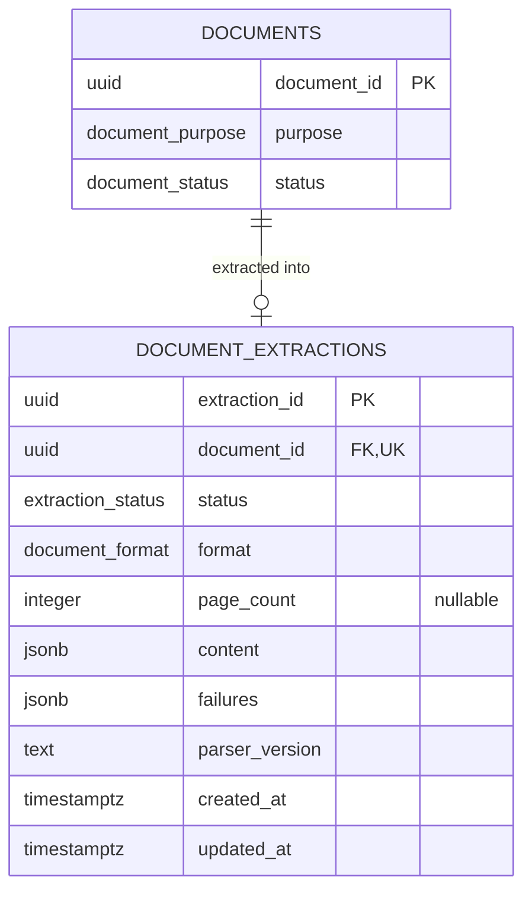
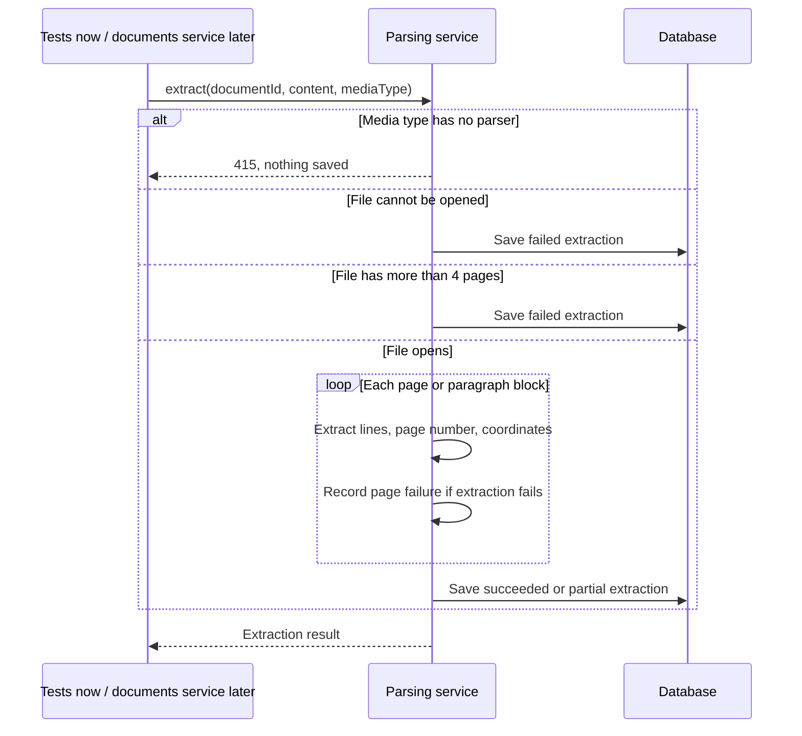

# Document parsing module plan (Part 1)

## Goal

Turn an uploaded CV (PDF or DOCX) into structured text where every line knows
its page and position, store the result, and keep successful pages when part
of a file fails.

## Scope

- Extract text from PDF and DOCX source documents.
- Keep line structure, page numbers, and on-page coordinates for PDF.
- Store one extraction result per document.
- Keep successful pages and record failed ones.
- Leave AI extraction, claims, source occurrences, OCR for scanned CVs,
  Arabic text, LinkedIn exports, certificate data from evidence documents,
  and public endpoints to Part 2 or later modules.

## Design decisions

- Add a `parsing` module that receives file bytes and a media type. It does
  not know where the file came from, so it works before the upload module is
  finished and later reads files through `documentsService` without changes.
- Parse `source` documents only; `evidence` documents are not parsed in Part 1.
- Use the Strategy pattern: one `DocumentParser` contract with a PDF parser
  and a DOCX parser, chosen by media type. A new format adds one parser without
  changing the rest.
- Use `pdfjs-dist` for PDF. It returns text with page numbers and coordinates.
- Group PDF text into lines. Each line keeps its text, its bounding box, and
  the original text pieces inside it, so any word can be traced to its page
  and position. A wide horizontal gap splits a line, so side-by-side columns
  are not merged. Lines are ordered top to bottom, then left to right; columns
  are not reordered.
- Store coordinates from the top-left corner, with each page's width and
  height, so a client can highlight text on the page.
- Use `mammoth` for DOCX. Word files have no fixed pages or coordinates, so
  DOCX results contain ordered paragraphs, including table cells, with
  `pageCount = null`.
- Treat a PDF page without a text layer (scanned image) as a page failure
  `NO_TEXT_LAYER`, and a page that cannot be read as `PAGE_UNREADABLE`; the
  other pages are kept.
- Fail the whole file when it cannot be opened (`UNREADABLE` or
  `PASSWORD_PROTECTED`), when it has no text (`NO_TEXT_LAYER`), or when a PDF
  has more than 4 pages (`TOO_MANY_PAGES`). Oversized PDFs are rejected before
  any page is read, to protect the server.
- Arabic text is not supported yet. PDFs store Arabic in drawing order with
  special letter forms, so the extracted text comes out reversed. A file whose
  letters are 5% Arabic or more fails with `UNSUPPORTED_LANGUAGE`; below that,
  Arabic characters are removed and the rest is kept. The rule applies to PDF
  and DOCX and lives in one place, `language.ts`.
- Reject media types without a parser with `415 UNSUPPORTED_DOCUMENT_TYPE`;
  nothing is saved.
- Store the extracted content as JSONB. It is read as a whole and never
  searched with SQL; search happens later on structured claims.
- Link `document_extractions.document_id` to `documents.document_id`.
  Deleting a document deletes its extraction.
- Record the parser library and version with every result.

## Relation to the documents table

The `documents` module merges the ERD's `SourceDocument` and
`EvidenceDocument` into one `documents` table with `purpose = source | evidence`.
Parsing fields from `SourceDocument` move as follows:

| ERD field | New location |
| --- | --- |
| `parsed_content` | `document_extractions.content` |
| `failed_portions` | `document_extractions.failures` |
| `processing_status` | `documents.status` |
| `error_details` | Short code in `documents.failure_code`; details in `document_extractions.failures` |
| `attempt_count` | Part 2, with retries |
| `unmapped_data` | Part 2, with AI extraction |

File fields such as name, format, size, hash, and storage reference stay in
`documents`. `EvidenceDocument` certificate fields belong to the later evidence
and verification module.

## Output contract

- `status`: `succeeded`, `partial`, or `failed`
- `format`: `pdf` or `docx`
- `pageCount`: number of pages, or `null` for DOCX
- `pages`: for each page, its number, width, height, and lines; each line has
  its text, bounding box, and text pieces
- `paragraphs`: for DOCX, ordered paragraphs with their index and text
- `failures`: failed page numbers with an error code
- `parserVersion`: library name and version

## Data model

- `extraction_status`: `succeeded`, `partial`, `failed`
- `document_format`: `pdf`, `docx`
- Parsing a document again replaces its extraction and updates `updated_at`.

## Parsing flow

## Implementation

- [x] Review this plan with the team.
- [x] Add PDF and DOCX test fixtures.
- [x] Define the input and output types.
- [x] Add the PDF reader with pages, lines, and coordinates.
- [x] Add the DOCX reader with ordered paragraphs.
- [x] Add partial results and error codes.
- [x] Add `document_extractions`, its migration, and the repository.
- [x] Share `parsingService` with other modules.
- [x] Update the data model documentation.

## Verification

- [x] Test single-page, multi-page, and two-column PDFs.
- [x] Test that each line has the correct page number and a box inside the page.
- [x] Test scanned, corrupt, password-protected, and oversized PDFs.
- [x] Test DOCX paragraphs, tables, and empty documents.
- [x] Test that mostly Arabic PDFs and DOCX files fail and small Arabic
  fragments are removed.
- [x] Test that partial results keep successful pages.
- [ ] Test saving and reading an extraction.
- [ ] Run focused tests, `npm test`, and `npm run build`.
- [ ] Have another team member test and review the code.
